# Linear and non-linear regressions
Jennifer Houmard, Sarah Durand, Alexis Lagarde
9 November 2026

- [<span class="toc-section-number">1</span> How does random noise
  affect linear
  regression?](#how-does-random-noise-affect-linear-regression)
  - [<span class="toc-section-number">1.1</span> Formulate your
    expectations](#formulate-your-expectations)
  - [<span class="toc-section-number">1.2</span> Implement and
    investigate](#implement-and-investigate)
    - [<span class="toc-section-number">1.2.1</span> Generating
      Synthetic Datasets](#generating-synthetic-datasets)
    - [<span class="toc-section-number">1.2.2</span> Fit a Linear
      Regression and Plot](#fit-a-linear-regression-and-plot)
    - [<span class="toc-section-number">1.2.3</span> Define a function
      to add linear regression and confidence intervals to the
      datasets](#define-a-function-to-add-linear-regression-and-confidence-intervals-to-the-datasets)
    - [<span class="toc-section-number">1.2.4</span> Plot the datasets
      with their regression and confidence
      intervals](#plot-the-datasets-with-their-regression-and-confidence-intervals)
    - [<span class="toc-section-number">1.2.5</span> Diagnostic
      Plots](#diagnostic-plots)
    - [<span class="toc-section-number">1.2.6</span> Statistical
      Tests](#statistical-tests)
    - [<span class="toc-section-number">1.2.7</span> Comparison of
      Regression Models](#comparison-of-regression-models)
  - [<span class="toc-section-number">1.3</span> Draw
    Conclusion](#draw-conclusion)
  - [<span class="toc-section-number">1.4</span> Propose a better
    numerical experiment](#propose-a-better-numerical-experiment)
    - [<span class="toc-section-number">1.4.1</span> Carry Out New
      Experiment](#carry-out-new-experiment)
- [<span class="toc-section-number">2</span> Finding a mathematical
  model for heart rate recovery after
  exercise](#finding-a-mathematical-model-for-heart-rate-recovery-after-exercise)
  - [<span class="toc-section-number">2.1</span> Formulate predictions
    from scientific
    literature](#formulate-predictions-from-scientific-literature)
    - [<span class="toc-section-number">2.1.1</span> Search
      strategy](#search-strategy)
    - [<span class="toc-section-number">2.1.2</span> Mathematical models
      of heart rate
      recovery](#mathematical-models-of-heart-rate-recovery)
    - [<span class="toc-section-number">2.1.3</span> Physiological
      mechanisms](#physiological-mechanisms)
    - [<span class="toc-section-number">2.1.4</span> Expected shape of
      the recovery curve](#expected-shape-of-the-recovery-curve)
    - [<span class="toc-section-number">2.1.5</span> Is one model
      sufficient?](#is-one-model-sufficient)
    - [<span class="toc-section-number">2.1.6</span> Our
      hypotheses](#our-hypotheses)
  - [<span class="toc-section-number">2.2</span> Three-hour cardio
    recording from effort to
    rest](#three-hour-cardio-recording-from-effort-to-rest)
    - [<span class="toc-section-number">2.2.1</span> Data import and
      preparation](#data-import-and-preparation)
    - [<span class="toc-section-number">2.2.2</span> Signal
      quality](#signal-quality)
    - [<span class="toc-section-number">2.2.3</span> Identifying the
      exercise and recovery
      periods](#identifying-the-exercise-and-recovery-periods)
    - [<span class="toc-section-number">2.2.4</span> Fitting the
      models](#fitting-the-models)
    - [<span class="toc-section-number">2.2.5</span> Model comparison
      and residual analysis](#model-comparison-and-residual-analysis)
    - [<span class="toc-section-number">2.2.6</span> Sensitivity
      analyses](#sensitivity-analyses)
    - [<span class="toc-section-number">2.2.7</span> Summary of findings
      for this recording](#summary-of-findings-for-this-recording)
  - [<span class="toc-section-number">2.3</span> 7.5-minute recording
    with a falling heart
    rate](#75-minute-recording-with-a-falling-heart-rate)
    - [<span class="toc-section-number">2.3.1</span> Test your
      predictions using the
      dataset](#test-your-predictions-using-the-dataset)
  - [<span class="toc-section-number">2.4</span> Draw
    conclusions](#draw-conclusions)
- [<span class="toc-section-number">3</span> Team workflow using
  Git](#team-workflow-using-git)
  - [<span class="toc-section-number">3.1</span> Repository and initial
    setup](#repository-and-initial-setup)
  - [<span class="toc-section-number">3.2</span> One file and one branch
    per part](#one-file-and-one-branch-per-part)
  - [<span class="toc-section-number">3.3</span> Pull requests and peer
    review](#pull-requests-and-peer-review)
  - [<span class="toc-section-number">3.4</span> Order of the
    merges](#order-of-the-merges)
  - [<span class="toc-section-number">3.5</span> Commit
    messages](#commit-messages)
  - [<span class="toc-section-number">3.6</span> What went wrong and
    what we learned](#what-went-wrong-and-what-we-learned)
- [References](#references)

[GitHub
repository](https://github.com/jenniferhoumard/IEAP-Series04-Rstudio)

# How does random noise affect linear regression?

In real-life experiments, we collect measurements and use linear
regression to estimate the relationship between variables. However, we
usually do not know the true relationship, and the data can contain
random noise. This makes it difficult to know how accurately the
regression line represents the underlying relationship.

Synthetic data allows us to investigate this problem because we can
define the true linear relationship ourselves and control the amount of
noise added. By increasing the noise while keeping the true relationship
the same, we can compare the estimated regression lines with the known
equation. This helps us understand how random noise affects the accuracy
and reliability of linear regression.

Although synthetic data cannot prove whether a relationship in real
measurements is correct, they help us understand the limitations of
regression when analyzing noisy experimental data.

## Formulate your expectations

A linear regression model describes the relationship between two
variables using a straight line.

$$\boxed{y = mx + b}$$

where:

- $m$ = the slope

- $b$ is the intercept.

In the pre-series, we learned about two types of random noise:

1.  **Additive noise:** Random errors are added to the data, more
    specifically to the dependent variable ($y$). The size of the errors
    does not depend on the original values of $y$.

$$\boxed{y_{\text{obs}} = mx + b + \varepsilon}$$

2.  **Multiplicative noise:** The dependent variable ($y$) is multiplied
    by random factors. This means the absolute errors can become larger
    when the original values of $y$ are larger.

$$\boxed{y_{\text{obs}} = (mx + b)\eta}$$

Both types of noise can also be combined, which can make simulated data
more realistic when measurements contain both types of error.

$$\boxed{y_{\text{obs}} = (mx + b)\eta + \varepsilon}$$

Adding noise makes the observed data points more scattered around the
true linear relationship.

**a). Estimated slope**

We expect the estimated slope and intercept to change when the noise
increases. The fitted line may become steeper or flatter depending on
where the noisy observations are located.

However, if the noise has a mean of zero and does not depend on x, we do
not expect the slope or intercept to always increase or decrease.
Instead, their estimates should become less precise as noise increases.

**b). Quality of predictions**

We expect predictions to become less accurate as noise increases. The
data points will generally be more spread out around the regression
line, leading to larger differences between observed and predicted
values (residuals or errors).

Noise can also affect the sample mean. In general, increasing the number
of observations makes the sample mean a more precise estimate of the
population mean. However, increasing random noise makes the sample mean
less precise.

If the noise has a mean of zero, positive and negative errors tend to
cancel out when enough observations are collected. Therefore, we expect
that a larger sample size can help reduce the effect of random noise on
our estimates.

**c). Explained variance**

We expect $R^2$ to generally decrease as noise increases. This is
because more of the variation in the data comes from random noise rather
than the relationship between x and y.

Therefore, the regression model will explain a smaller proportion of the
observed variation.

**d). Estimated linear relationships**

We expect the estimated regression lines to be different as random noise
increases. This is because noise makes the data points more scattered,
which can change the estimated slope and intercept. As a result, the
observed linear relationships will generally become less clear, and the
regression model will explain less of the variation in the data.

However, the true linear relationship used to generate the data will
remain the same because we are only adding random noise to the
observations, not changing the original equation used to generate the
data. Only the estimated regression lines may change.

## Implement and investigate

To investigate how random noise affects linear regression, we generated
three synthetic data sets using the same underlying linear relationship.
The original linear relationship is defined as:

$$\boxed{y_{\text{true}}=2x+5}$$ As in the pre-series, we combined
additive and multiplicative noise to simulate data:

$$\boxed{y_{\text{obs}} = (2x + 5)\eta + \varepsilon}$$

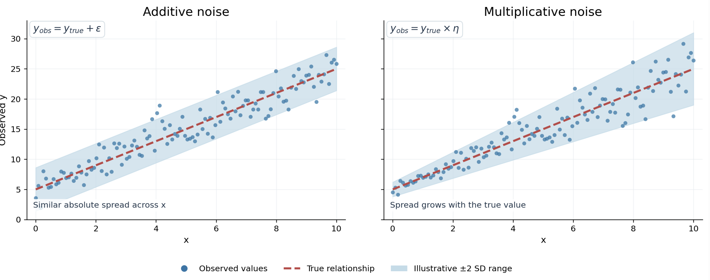

**Additive noise** has a mean of 0 because the errors are centered
around 0. This means that positive and negative errors tend to cancel
out on average when enough observations are collected. If the errors had
a positive or negative mean, the observed values would be systematically
overestimated or underestimated compared to the true values. We want the
observed values to remain equal to the true values on average because we
are keeping the underlying linear relationship the same. Only the data
points should become more scattered around the true linear relationship.
Adding 0 to the true value does not change the overall average trend,
which is what we want.

$$\boxed{y_{\text{obs}} = y_{\text{true}} + \varepsilon}$$

**Multiplicative noise** has a mean of 1 because the factors that
multiply the true values are centered around 1. Multiplying the true
values by 1 does not change the overall average trend, which is what we
want. This means there will be no systematic overestimation or
underestimation of the observed values.

$$\boxed{y_{\text{obs}} = y_{\text{true}} * \eta}$$

The goal is to increase the amount of random variation without changing
the true underlying relationship. To do this, we maintain a mean of 1
for the multiplicative factor and 0 for the additive noise, so the
observed values remain centered around the true linear relationship.
However, we increase the standard deviation of the noise to create more
random variation. This will generally increase the distance between the
observed values and the true linear relationship.

### Generating Synthetic Datasets

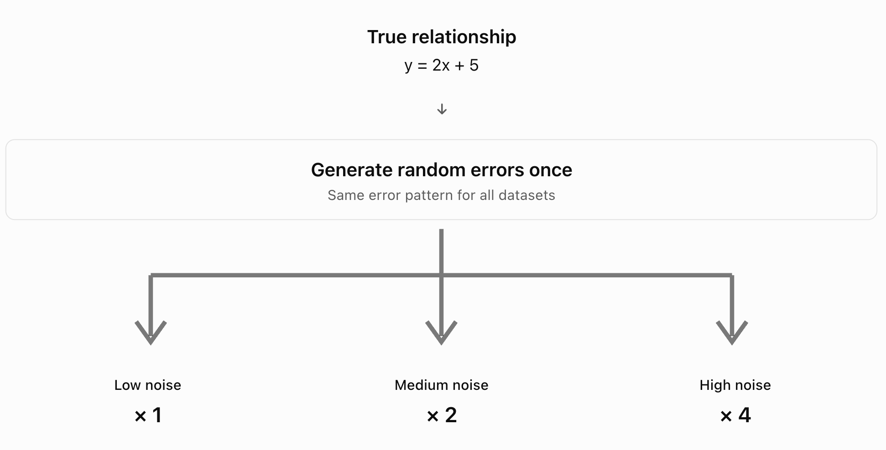

We generated three datasets from the same true relationship, (y = 2x +
5), allowing us to compare how increasing noise affects the regression
results. Each contains 120 observations with the same values of (x),
ranging from 0 to 10.

We first generated additive and multiplicative noise using random
numbers. We then used these same numbers for all three datasets, but
multiplied them by 1, 2 and 4 to create low, medium and high noise
levels.

This means we generate random errors once. Instead of generating
completely new errors for every dataset, we make those original errors
twice as large for the second dataset and four times as large for the
third.

We used set.seed(123) to make sure we obtain the same results each time
we run the code.

We chose to use the same random errors multiplied by 1, 2 and 4 rather
than generating completely different errors for each dataset because
this allows us to control the experiment because only the magnitude of
the noise changes, while the random error pattern remains the same.

If we generated different random errors for each dataset, some errors
could partly cancel each other out by chance. This means that a dataset
with higher noise could sometimes produce regression estimates closer to
the true values than a dataset with lower noise. We would then have
difficulty determining whether the differences between the models were
caused by the amount of noise or simply by the particular random errors
generated.

By keeping the same error pattern and increasing only its magnitude, we
can more clearly observe how increasing noise affects the regression
results.

``` r
# 1. Define the true linear relationship

set.seed(123) # reproduces the same random numbers every time the code is run

n <- 120 # number of observations

x <- seq(0, 10, length.out = n) # 120 values from 0 to 10

y_true <- 2 * x + 5 # true linear relationship without noise
```

For multiplicative noise, we want to increase the standard deviation
without changing the mean of the multiplicative factor, which should
stay at 1.

If we generate multiplicative noise with a mean of 1 and then multiply
it by 2 or 4, the mean would also increase to 2 or 4. This would change
the original linear relationship, which is not what we want.

Instead, we generate multiplicative errors with a mean of 0, so
multiplying them by 2 or 4 increases their standard deviation without
changing their mean. We then add 1 in the equation to keep the
multiplicative factor centered around 1.

For additive noise, we do not need to add 1 because it is already
centered around 0. Multiplying the errors by 2 or 4 increases their
standard deviation while keeping their mean at 0.

``` r
# 2. Generate additive and multiplicative noise once

# Additive noise
additive_noise <- rnorm(n, mean = 0, sd = 1) 
# Generate additive random errors centered around 0

multiplicative_noise <- rnorm(n, mean = 0, sd = 0.050) 
# Generate multiplicative random errors centered around 0
```

``` r
# 3. Generate three datasets with increasing noise

# Low noise level
y_low <- data.frame(
  x = x,
  y_obs = y_true * (1 + multiplicative_noise) + additive_noise
)

# Medium noise level
y_medium <- data.frame(
  x = x,
  y_obs = y_true * (1 + 2 * multiplicative_noise) + 2 * additive_noise
)

# High noise level
y_high <- data.frame(
  x = x,
  y_obs = y_true * (1 + 4 * multiplicative_noise) + 4 * additive_noise
)
```

### Fit a Linear Regression and Plot

``` r
# 4. Fit linear regression models to each dataset

lm_low <- lm(y_obs ~ x, data = y_low) # low noise
lm_medium <- lm(y_obs ~ x, data = y_medium) # medium noise
lm_high <- lm(y_obs ~ x, data = y_high) # high noise

# 5. Summary statistics for each model

summary(lm_low)
```

    Call:
    lm(formula = y_obs ~ x, data = y_low)

    Residuals:
        Min      1Q  Median      3Q     Max 
    -2.5529 -0.8675  0.0082  0.8094  4.1142 

    Coefficients:
                Estimate Std. Error t value Pr(>|t|)    
    (Intercept)  5.13941    0.22124   23.23   <2e-16 ***
    x            1.97142    0.03824   51.55   <2e-16 ***
    ---
    Signif. codes:  0 '***' 0.001 '**' 0.01 '*' 0.05 '.' 0.1 ' ' 1

    Residual standard error: 1.219 on 118 degrees of freedom
    Multiple R-squared:  0.9575,    Adjusted R-squared:  0.9571 
    F-statistic:  2658 on 1 and 118 DF,  p-value: < 2.2e-16

``` r
summary(lm_medium)
```

    Call:
    lm(formula = y_obs ~ x, data = y_medium)

    Residuals:
        Min      1Q  Median      3Q     Max 
    -5.1059 -1.7350  0.0164  1.6187  8.2284 

    Coefficients:
                Estimate Std. Error t value Pr(>|t|)    
    (Intercept)  5.27882    0.44247   11.93   <2e-16 ***
    x            1.94283    0.07648   25.40   <2e-16 ***
    ---
    Signif. codes:  0 '***' 0.001 '**' 0.01 '*' 0.05 '.' 0.1 ' ' 1

    Residual standard error: 2.439 on 118 degrees of freedom
    Multiple R-squared:  0.8454,    Adjusted R-squared:  0.8441 
    F-statistic: 645.3 on 1 and 118 DF,  p-value: < 2.2e-16

``` r
summary(lm_high)
```

    Call:
    lm(formula = y_obs ~ x, data = y_high)

    Residuals:
         Min       1Q   Median       3Q      Max 
    -10.2117  -3.4700   0.0329   3.2374  16.4569 

    Coefficients:
                Estimate Std. Error t value Pr(>|t|)    
    (Intercept)   5.5576     0.8849    6.28 5.84e-09 ***
    x             1.8857     0.1530   12.33  < 2e-16 ***
    ---
    Signif. codes:  0 '***' 0.001 '**' 0.01 '*' 0.05 '.' 0.1 ' ' 1

    Residual standard error: 4.877 on 118 degrees of freedom
    Multiple R-squared:  0.5629,    Adjusted R-squared:  0.5592 
    F-statistic:   152 on 1 and 118 DF,  p-value: < 2.2e-16

### Define a function to add linear regression and confidence intervals to the datasets

``` r
# 6. Define a function to add linear regression and confidence intervals to the datasets

add_regression_to_data <- function(data, model, ci = 0.95) {

  conf_interval <- predict(model, interval = "confidence", level = ci)
  # Calculate the fitted values and confidence interval limits

  data <- cbind(data, conf_interval)
  # Add these values as new columns in the dataset

  return(data) # Return the updated dataset
}
```

``` r
# 7. Apply the function to the three datasets

# Low noise 
y_low_ci <- add_regression_to_data(y_low, lm_low)

# Medium noise
y_medium_ci <- add_regression_to_data(y_medium, lm_medium)

# High noise
y_high_ci <- add_regression_to_data(y_high, lm_high)

#print(y_low)
#print(y_medium)
#print(y_high)
```

### Plot the datasets with their regression and confidence intervals

``` r
# 8.Function to plot the datasets with its regression and confidence interval

plot_regression <- function(data, title) {

  ggplot(data, aes(x = x, y = y_obs)) +
    geom_ribbon(aes(ymin = lwr, ymax = upr),
                fill = "lightblue", alpha = 0.3) + # 95% confidence interval
    geom_point() + # Observed data points
    geom_line(aes(y = fit, color = "Estimated regression")) + # Fitted regression
    geom_line(aes(y = 2 * x + 5, color = "True relationship")) + # True regression
    scale_color_manual(values = c(
      "Estimated regression" = "blue",
      "True relationship" = "red"
    )) +
    labs(title = title, x = "x", y = "Observed y", color = "Lines") +
    theme_minimal()
}

# Generate the three plots separately
plot_regression(y_low_ci, "Low Noise")
```

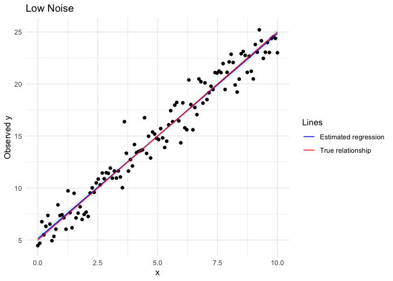

``` r
plot_regression(y_medium_ci, "Medium Noise")
```

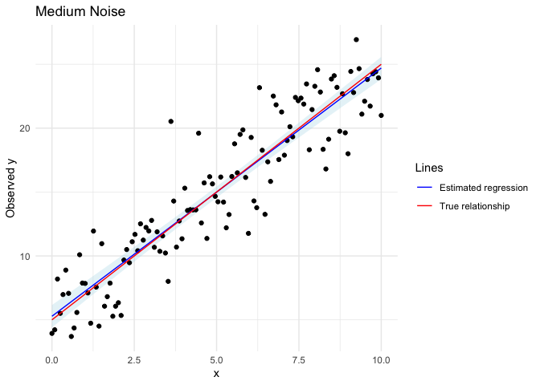

``` r
plot_regression(y_high_ci, "High Noise")
```

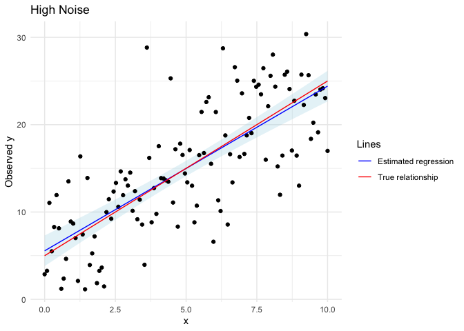

### Diagnostic Plots

All three models produce nearly identical diagnostic patterns, despite
having different noise levels. This is because we used the same random
errors for all three datasets. Consequently, the residuals follow
exactly the same pattern, but their magnitudes are multiplied by 1, 2
and 4.

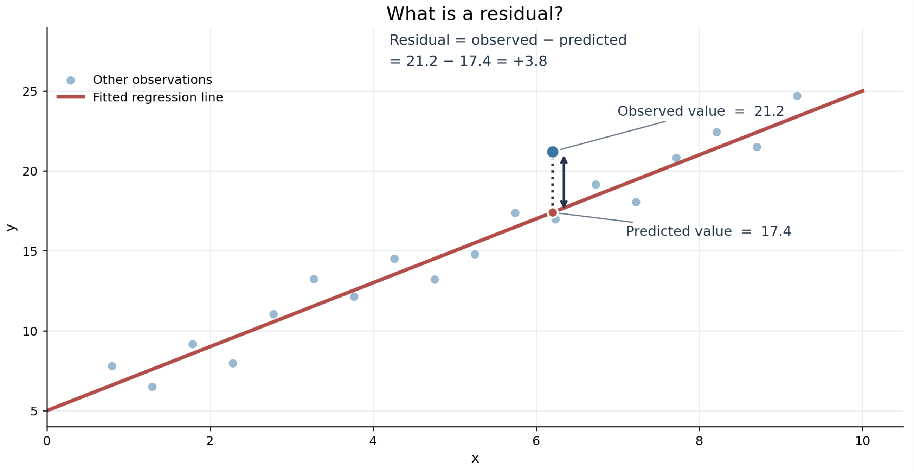

A residual is the difference between an observed value and the value
predicted by the regression model.

``` r
# 9. Diagnostic plots for low noise
plot(lm_low)
```

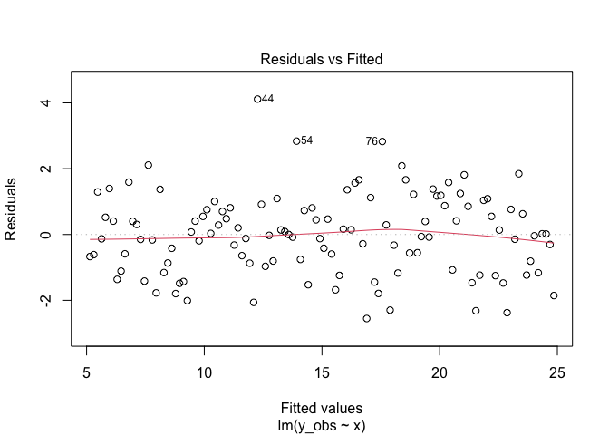

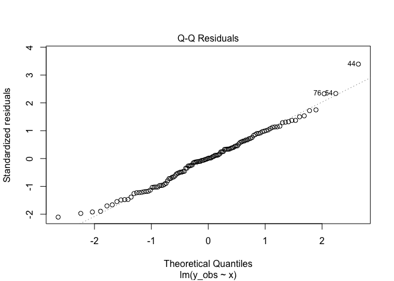


``` r
# Diagnostic plots for medium noise
plot(lm_medium)
```

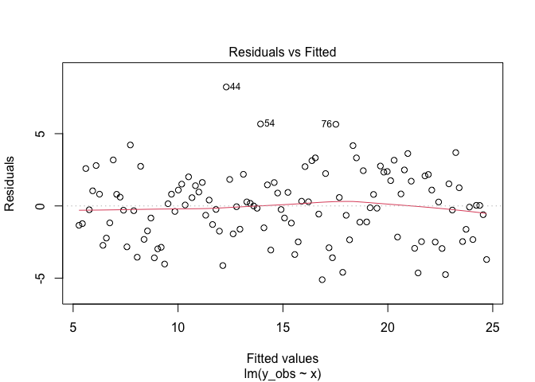


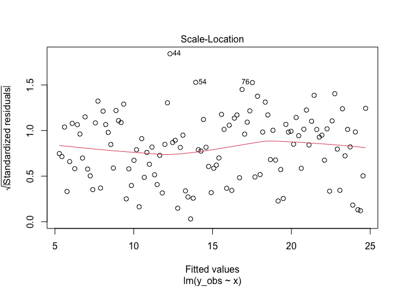

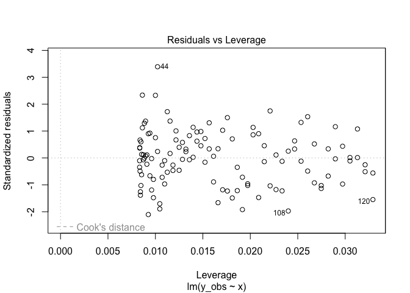

``` r
# Diagnostic plots for high noise
plot(lm_high)
```

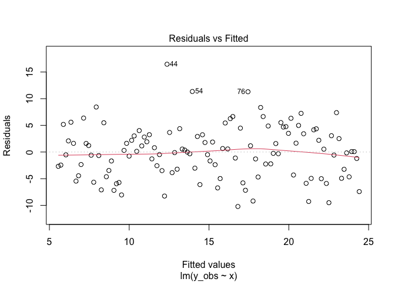


**a) Residuals vs Fitted:** The residuals are scattered around zero
without a strong curved pattern, suggesting that a linear relationship
is appropriate. However, the absolute residual values increase
substantially between the low-, medium- and high-noise models.

**b) Normal Q-Q:** Most points follow the reference line, with some
deviations at the extremes. This suggests that the residuals are
approximately normally distributed.

**c) Scale-Location:** The points show no strong increasing or
decreasing pattern in their spread, although there are small variations.
There is no clear visual evidence of strongly non-constant variance.

**d) Residuals vs Leverage:** A few observations have relatively large
standardized residuals, particularly observation 44, but there is no
obvious evidence of highly influential observations based on the plots.

### Statistical Tests

After fitting the three linear regression models, we checked the
residuals to see whether the assumptions of linear regression were
satisfied.

The **Shapiro-Wilk test** checks whether the residuals are normally
distributed. In linear regression, the original data do not need to be
normally distributed, but the errors are assumed to be normally
distributed for the usual statistical tests and confidence intervals to
be exact. This is because these tests use mathematical distributions to
calculate p-values and confidence intervals. When the errors are
normally distributed, we know how the estimated regression coefficients
are expected to vary, allowing us to calculate their uncertainty. If the
errors are not normally distributed, these calculations may be less
accurate, especially with small samples. However, normality is not
necessary to calculate the regression line itself.

The **Breusch-Pagan test** checks whether the residual variance is
constant (homoscedasticity). This means checking whether the errors have
around the same spread across the fitted/predicted values. If the
variance is not constant, the usual standard errors and confidence
intervals may be unreliable.

We use a standard significance level of 0.05 to interpret both tests.

| Test | p-value ≥ 0.05 | p-value \< 0.05 |
|----|----|----|
| Shapiro–Wilk | No significant evidence against normality | Evidence that residuals are not normally distributed |
| Breusch–Pagan | No significant evidence against constant variance | Evidence that residual variance is not constant |

A p-value above 0.05 does not prove that an assumption is satisfied.

``` r
# 10. Check the residuals of the three regression models

# a) Shapiro-Wilk test: check if residuals are normally distributed

shapiro.test(residuals(lm_low)) # low noise
```

        Shapiro-Wilk normality test

    data:  residuals(lm_low)
    W = 0.98779, p-value = 0.3589

``` r
shapiro.test(residuals(lm_medium)) # medium noise
```

        Shapiro-Wilk normality test

    data:  residuals(lm_medium)
    W = 0.98779, p-value = 0.3589

``` r
shapiro.test(residuals(lm_high)) # high noise
```

        Shapiro-Wilk normality test

    data:  residuals(lm_high)
    W = 0.98779, p-value = 0.3589

``` r
# b) Breusch-Pagan test: check if residual variance is constant

bptest(lm_low) # low noise
```

        studentized Breusch-Pagan test

    data:  lm_low
    BP = 0.39386, df = 1, p-value = 0.5303

``` r
bptest(lm_medium) # medium noise
```

        studentized Breusch-Pagan test

    data:  lm_medium
    BP = 0.39386, df = 1, p-value = 0.5303

``` r
bptest(lm_high) # high noise
```

        studentized Breusch-Pagan test

    data:  lm_high
    BP = 0.39386, df = 1, p-value = 0.5303

### Comparison of Regression Models

**1. Low Noise:**

The estimated intercept is 5.139 and the slope is 1.971, both very close
to the true values of 5 and 2. The R² of 0.958 indicates that the model
explains approximately 95.8% of the variation in the observed data. The
residual standard error of 1.219 shows that observations are relatively
close to the fitted regression line.

In the regression plot, the observed points are closely grouped around
the true relationship. The estimated regression line almost overlaps
with the true line, and the confidence interval is narrow.

**2. Medium Noise:**

The estimated intercept increases to 5.279, while the slope decreases to
1.943, moving slightly further from the true values. The R² decreases to
0.845, meaning the model now explains approximately 84.5% of the
variation. The residual standard error increases to 2.439, approximately
twice that of the low-noise model.

The observed points are more scattered around the regression line, and
the confidence interval becomes wider. However, the estimated regression
line remains close to the true relationship.

**3. High Noise:**

The estimated intercept is 5.558 and the slope is 1.886, showing the
largest differences from the true values. The R² decreases further to
0.563, meaning the model explains only 56.3% of the variation. The
residual standard error increases to 4.877, four times that of the
low-noise model.

The regression plot shows much greater scatter around the line, and the
confidence interval is considerably wider. Although the estimated
regression line still follows the overall linear trend, its coefficients
are less precise.

As noise increases, the estimated coefficients move further from the
true values. This happens because of how we designed the experiment: we
multiply the same random errors by 1, 2 and 4. With different random
errors, the coefficients might not follow the same pattern.

We also examine how noise affects the quality of the regression model.
As noise increases, R² decreases, meaning the model explains less of the
variation in the data. At the same time, the standard errors increase,
meaning our estimates become less precise.

The slope remains statistically significant in all three models (p-value
\< 0.001). This means that even at high noise levels, there is strong
evidence of a linear relationship, although the model explains less of
the observed variation.

``` r
# 11. Create a table to compare the three regression models

comparison <- data.frame(
  Noise = c("Low", "Medium", "High"),

  Intercept = c(coef(lm_low)[1],
                coef(lm_medium)[1],
                coef(lm_high)[1]),

  Slope = c(coef(lm_low)[2],
            coef(lm_medium)[2],
            coef(lm_high)[2]),

  R_squared = c(summary(lm_low)$r.squared,
                summary(lm_medium)$r.squared,
                summary(lm_high)$r.squared),

  Residual_SE = c(summary(lm_low)$sigma,
                  summary(lm_medium)$sigma,
                  summary(lm_high)$sigma),

  # Standard error of the estimated slope
  Slope_SE = c(summary(lm_low)$coefficients[2, 2],
               summary(lm_medium)$coefficients[2, 2],
               summary(lm_high)$coefficients[2, 2]),

  # Shapiro-Wilk test p-values
  Shapiro_p = c(shapiro.test(residuals(lm_low))$p.value,
                shapiro.test(residuals(lm_medium))$p.value,
                shapiro.test(residuals(lm_high))$p.value),

  # Breusch-Pagan test p-values
  BP_p = c(bptest(lm_low)$p.value,
           bptest(lm_medium)$p.value,
           bptest(lm_high)$p.value)
)

# Display the comparison as a table in the PDF
knitr::kable(comparison, digits = 3)
```

| Noise  | Intercept | Slope | R_squared | Residual_SE | Slope_SE | Shapiro_p | BP_p |
|:-------|----------:|------:|----------:|------------:|---------:|----------:|-----:|
| Low    |     5.139 | 1.971 |     0.957 |       1.219 |    0.038 |     0.359 | 0.53 |
| Medium |     5.279 | 1.943 |     0.845 |       2.439 |    0.076 |     0.359 | 0.53 |
| High   |     5.558 | 1.886 |     0.563 |       4.877 |    0.153 |     0.359 | 0.53 |

**4. Statistical Tests:**

The Shapiro–Wilk and Breusch–Pagan tests also produce identical results
because multiplying all residuals by the same positive number does not
change their test statistics.

For the Shapiro–Wilk test, all p-values are greater than 0.05.
Therefore, we do not find significant evidence that the residuals
deviate from normality.

For the Breusch–Pagan test, all p-values are also greater than 0.05.
Therefore, we do not find significant evidence that the residual
variance is non-constant.

## Draw Conclusion

Our main expectations were confirmed. As random noise increased, the
observations became more scattered, the regression models explained less
variation, and the estimated coefficients became less precise.

The differences between the three models support this. R² decreased from
0.958 to 0.563, while the residual standard error increased from 1.219
to 4.877. The slope and intercept also moved further from their true
values.

These results suggest that increasing noise reduces regression fit and
prediction precision. With more noise, individual observations are
harder to predict accurately, and we become less certain about the
estimated relationship. However, all three models still detected a
statistically significant linear relationship, showing that a
relationship can remain detectable even when the observations contain
substantial noise.

Finally, the diagnostic tests showed that increasing the magnitude of
the noise did not change the residual distribution or its relative
pattern in our experiment. Therefore, more noise does not automatically
mean that the assumptions of linear regression are violated.

## Propose a better numerical experiment

We could also test additive and multiplicative noise separately to
better understand how each type affects regression estimates and model
assumptions. However, combining both types of noise is also important
because real-world data can contain several sources of error at the same
time.

Another improvement would be to evaluate the models using a separate
test dataset. This would allow us to measure how increasing noise
affects the accuracy of predictions on new observations, rather than
only evaluating how well the models fit the original data.

We could extend the experiment to other relationships, such as
quadratic, polynomial or exponential relationships, because real-world
data do not always follow a straight line. We could then investigate
whether increasing noise has similar effects on different types of
regression models.

We could also compare these models with more flexible machine learning
methods. Unlike models where we choose a specific equation, some machine
learning methods can learn complex patterns directly from the data. This
could be useful when the underlying relationship is unknown.

However, more flexible models are not necessarily better because they
may also learn random errors rather than the true relationship, which is
called overfitting. By comparing the models at different noise levels
and evaluating their predictions on separate test data, we could
investigate whether more flexible models improve prediction accuracy or
become more sensitive to noise.

### Carry Out New Experiment

To better understand how noise affects regression, we repeat the
experiment 1,000 times for each noise level, generating new random
errors each time.

Unlike our first experiment, which only shows one possible result,
repeating the simulation helps us understand the general effect of
increasing noise. This helps us see whether more noise causes the
estimates to become less precise, rather than consistently increasing or
decreasing.

We keep the true relationship ($y = 2x + 5$) and the 120 x-values
unchanged. We then compare the mean and standard deviation (SD) of the
estimated slopes and intercepts.

**Repeat the Experiment 1000 Times:**

``` r
# Repeat the experiment 1000 times for each noise level

set.seed(456)

results <- data.frame() # store all estimates (total 3,000 rows)

for (level in c(1, 2, 4)) {           # Loop over different noise levels 

  estimates <- replicate(1000, {  # stores slope and intercept for 1000 simulations

    # 1. Generate new random errors each time
    additive <- rnorm(n, mean = 0, sd = 1)
    multiplicative <- rnorm(n, mean = 0, sd = 0.05)

    # 2. Generate observations with the chosen noise level
    y_obs <- y_true * (1 + level * multiplicative) + level * additive

    # 3. Fit the linear regression 
    model <- lm(y_obs ~ x)
    
    # 4. Extract the estimated coefficients (intercept and slope)
    coef(model)
    
    })
    
    # 5. Create a table with the 1000 estimates
new_results <- data.frame(
  Noise = level,
  Intercept = estimates[1, ], # second row contains the slope estimates
  Slope = estimates[2, ] # third row contains the intercept estimates
)

# 6. Add these estimates to the results table
results <- rbind(results, new_results)

}

# 7. Calculate the mean and SD for each noise level
comparison_1000 <- results |>
  group_by(Noise) |>
  summarise(
    Mean_Intercept = mean(Intercept),
    SD_Intercept = sd(Intercept),
    Mean_Slope = mean(Slope),
    SD_Slope = sd(Slope),
    .groups = "drop" # prevent grouping in the output
  )

# Display the results in a table
knitr::kable(comparison_1000, digits = 3) 
```

| Noise | Mean_Intercept | SD_Intercept | Mean_Slope | SD_Slope |
|------:|---------------:|-------------:|-----------:|---------:|
|     1 |          5.011 |        0.204 |      1.999 |    0.040 |
|     2 |          5.006 |        0.414 |      1.999 |    0.084 |
|     4 |          4.943 |        0.818 |      2.010 |    0.160 |

After 1,000 simulations for each noise level, the average slope stays
close to the true value of 2, and the average intercept stays close to
5. However, their standard deviations increase as noise increases.

**Visualize the Results:**

A boxplot helps us see how much the estimated slopes vary across the
1,000 simulations compared with the true slope of 2 (dashed line).

``` r
# Compare the slope estimates for each noise level
ggplot(results, aes(x = factor(Noise), y = Slope)) + # factor creates 3 seperate box plots for each noise level
  geom_boxplot() +
  geom_hline(yintercept = 2, linetype = "dashed") +
  labs(
    title = "Slope estimates across 1000 simulations",
    x = "Noise level",
    y = "Estimated slope"
  )
```

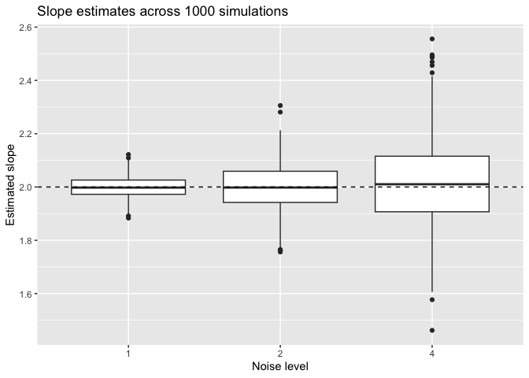

The boxplots show that the spread of estimated slopes becomes wider as
noise increases, while the values remain centered around the true slope
of 2 (dashed line). This makes the effect of increasing noise easier to
see.

This shows that more noise makes the regression estimates less precise,
but does not consistently make them larger or smaller. It does not cause
change in any particular direction. Repeating the experiment gives us a
more reliable conclusion than using only one simulation.

# Finding a mathematical model for heart rate recovery after exercise

## Formulate predictions from scientific literature

### Search strategy

We started from the heart rate recovery (HRR) model presented in M.
Desroches’ course (Master IEAP, *Modelling using Dynamical Systems*) and
from the scientific reference it cites (Cole et al., 1999). We then
searched Google Scholar and PubMed for articles on the modelling and
physiology of HRR, using the keywords “heart rate recovery”,
“exponential” and “time constant”. We selected a review on the
physiological mechanisms (Pierpont et al., 2013) and a study comparing
mono- and bi-exponential models (Joseph et al., 2023). The study by Imai
et al. (1994), cited in several of these articles, was not accessible,
so we cite it through Pierpont et al. (2013).

### Mathematical models of heart rate recovery

In the literature, HRR is described in two ways.

**1. With a simple index.** Cole et al. (1999) defined HRR as the
decrease in heart rate (HR) between peak exercise and the first minute
after exercise. A decrease of 12 bpm or less was considered abnormal and
was a strong predictor of mortality. This index is easy to measure, but
it does not describe the shape of the recovery curve.

**2. With a continuous model.** The simplest model assumes that the rate
of recovery is proportional to the difference between the current HR and
the resting HR:

$$HR'(t) = -k\,(HR - HR_{rest}), \qquad k > 0$$

Its solution is a mono-exponential decay:

$$HR(t) = HR_{rest} + (HR_0 - HR_{rest})\,e^{-kt}$$

The time constant $\tau = 1/k$ is the time needed for the excess HR to
fall to about 37% of its initial value.

Other models can be considered:

- a **linear model**, which assumes a constant decrease in HR. It is not
  physiologically plausible, because it predicts that HR keeps falling
  indefinitely;

- a **bi-exponential model**, with two time constants (a fast phase and
  a slow phase):

  $$HR(t) = HR_{min} + A_1 e^{-t/\tau_1} + A_2 e^{-t/\tau_2}$$

  Joseph et al. (2023) compared the two exponential models on 5 min of
  recovery after a maximal treadmill test in 36 men. The
  mono-exponential model gave $\tau \approx 65$ s, and the
  bi-exponential model gave $\tau_1 \approx 44$ s and
  $\tau_2 \approx 120$ s. The bi-exponential model fitted better in 61%
  of participants, and equally well in the others.

### Physiological mechanisms

HR depends on the intrinsic activity of the sinus node, modulated by the
parasympathetic and sympathetic nervous systems (Pierpont et al., 2013).
During exercise, HR first increases through parasympathetic withdrawal,
then through sympathetic activation as intensity increases (Cole et al.,
1999; Pierpont et al., 2013). When exercise stops, two mechanisms bring
HR back towards rest: parasympathetic (vagal) reactivation and
sympathetic withdrawal (Joseph et al., 2023).

Their respective contributions over time are debated. Imai et
al. (1994), cited by Pierpont et al. (2013), concluded that the
immediate decrease in HR is mainly due to parasympathetic reactivation.
This is consistent with the fact that plasma norepinephrine peaks about
1 min after intense exercise: sympathetic activity therefore remains
high at the beginning of recovery (Pierpont et al., 2013). Sympathetic
withdrawal is slower, because circulating catecholamines continue to act
on the heart (Joseph et al., 2023).

### Expected shape of the recovery curve

Based on the mono-exponential model, we expect a recovery curve that:

- decreases monotonically;
- falls quickly at first, then more and more slowly;
- tends towards a stable level (asymptote) without going below it.

The first minute of recovery is critical: a decrease of 12 bpm or less
during this minute is considered abnormal (Cole et al., 1999).

### Is one model sufficient?

The mono-exponential model relies on simplifying assumptions: $k$ and
$HR_{rest}$ are constant, and recovery is described by a single time
scale. It does not take into account continued movement, posture or
measurement noise. In practice, recovery is often active: in the study
by Cole et al. (1999), patients kept walking (2.4 km/h, 2.5% grade)
during recovery, whereas in Joseph et al. (2023) they recovered lying
supine.

According to Pierpont et al. (2013), a simple exponential decay
adequately describes recovery after low-intensity exercise, which is
dominated by vagal reactivation, but recovery after intense exercise is
more complex. Joseph et al. (2023) interpret the two time constants of
the bi-exponential model as reflecting the combined action of the two
branches of the autonomic nervous system, which have different kinetics.
A single mono-exponential model may therefore not be sufficient to
describe the entire recovery period, especially after intense exercise
or over a long recording.

### Our hypotheses

- **H1:** the mono-exponential model will describe recovery better than
  the linear model (lower AIC, less structured residuals).
- **H2:** after intense exercise and over a sufficiently long period,
  the bi-exponential model will fit better than the mono-exponential
  model, with a fast time constant of about 40–60 s and a slower one of
  about 2 min (Joseph et al., 2023). For a short recording or after
  moderate exercise, a mono-exponential model may be sufficient
  (Pierpont et al., 2013).
- **H3:** periods during which the participant keeps moving will deviate
  from the model, and the estimated plateau will be higher than resting
  HR during active recovery.

## Three-hour cardio recording from effort to rest

### Data import and preparation

We analyse a 3-hour-and-10-minute recording from an Aidlab chest strap
(MIT licence) to identify the exercise and recovery periods, and to
compare linear, mono-exponential and bi-exponential models of heart rate
recovery.

We use the RR intervals as our main signal because they provide one
heart rate value per beat (about 16 700 values), whereas the device
pulse signal provides one value about every 5 s (2 456 values). This
allows us to follow heart rate changes in greater detail. Each RR
interval is the time between two heartbeats in milliseconds; we convert
it into heart rate in beats per minute with $HR = 60\,000 / RR$. The
pulse signal is kept as an independent check.

We also use the acceleration to estimate movement, and the body position
to examine posture. All timestamps are converted into time since the
start of the recording, so that the signals can be compared.

To summarise movement, we compute the standard deviation of the
acceleration magnitude in 60-s windows. Section 04 uses 10-s windows for
its much shorter 7-min-30-s recording; over three hours, longer windows
make the overall movement patterns easier to see, although they may hide
very brief movements.

``` r
library(tidyverse)

# ---------------------------------------------------------------
# 1. Location of the data and start time of the recording
# ---------------------------------------------------------------

# Folder where the unzipped files are stored
r3h_dir <- "data/cardio-recovery-3h10m"

# dataset.json contains the metadata (title, start/end time, signals...)
r3h_meta <- jsonlite::read_json(file.path(r3h_dir, "dataset.json"))

# Start of the recording, in Unix milliseconds.
# We use it as the time origin: every timestamp will be expressed
# relative to this moment.
r3h_t0 <- r3h_meta$from_timestamp_ms


# ---------------------------------------------------------------
# 2. Beat-to-beat heart rate from RR intervals (main signal)
# ---------------------------------------------------------------

r3h_rr <- read_csv(file.path(r3h_dir, "rr.csv"),
                   show_col_types = FALSE) |>   # hide the column message
  mutate(
    # timestamp is in ms since 1970 -> subtract the start and
    # divide by 1000 to get seconds since the start of the recording
    t     = (timestamp - r3h_t0) / 1000,
    # same time in minutes (easier to read on 3-hour plots)
    t_min = t / 60,
    # "value" = time between two heartbeats, in milliseconds
    rr    = value,
    # heart rate in bpm: 60 000 ms in one minute / duration of one beat
    hr    = 60000 / rr
  )


# ---------------------------------------------------------------
# 3. Heart rate computed by the device ("pulse", ~1 value / 5 s)
#    -> used only as an independent check of the RR-based HR
# ---------------------------------------------------------------

r3h_pulse <- read_csv(file.path(r3h_dir, "pulse.csv"),
                      show_col_types = FALSE) |>
  mutate(
    t     = (timestamp - r3h_t0) / 1000,   # seconds from start
    t_min = t / 60,                        # minutes from start
    hr    = value                          # already in bpm
  )


# ---------------------------------------------------------------
# 4. Movement from the accelerometer
# ---------------------------------------------------------------
# The accelerometer gives x, y, z (in g) many times per second.
# 1) We combine the 3 axes into one magnitude: sqrt(x^2 + y^2 + z^2)
# 2) We compute its standard deviation (SD) in 60-s windows:
#    - SD close to 0  -> the person is still
#    - larger SD      -> the person is moving

r3h_acc <- read_csv(file.path(r3h_dir, "acceleration.csv"),
                    show_col_types = FALSE) |>   # big file: takes a few seconds
  mutate(
    t   = (timestamp - r3h_t0) / 1000,     # seconds from start
    mag = sqrt(x^2 + y^2 + z^2)            # magnitude of acceleration
  ) |>
  # floor(t / 60) * 60 = start of the 60-s window the sample belongs to
  # + 30           = middle of the window (better for plotting)
  group_by(t = floor(t / 60) * 60 + 30) |>
  summarise(acc_sd = sd(mag),              # movement indicator per window
            .groups = "drop") |>
  mutate(t_min = t / 60)                   # minutes from start


# ---------------------------------------------------------------
# 5. Body position (code + text label)
# ---------------------------------------------------------------

r3h_pos <- read_csv(file.path(r3h_dir, "body-position.csv"),
                    show_col_types = FALSE) |>
  mutate(t     = (timestamp - r3h_t0) / 1000,
         t_min = t / 60)

# Look at the column names (we don't know them in advance)
names(r3h_pos)
```

    [1] "timestamp" "value"     "position"  "t"         "t_min"    

``` r
# Count how many times each position code/label appears
# (across(-c(timestamp, t, t_min)) = all columns except the time ones)
r3h_pos |>
  count(across(-c(timestamp, t, t_min)))
```

    # A tibble: 5 × 3
      value position      n
      <dbl> <chr>     <int>
    1     0 unknown     192
    2     1 prone         9
    3     2 supine        1
    4     3 leftSide      2
    5     4 rightSide     2

``` r
# ---------------------------------------------------------------
# 6. Summary table: how many points and which time span per signal
# ---------------------------------------------------------------

tibble(
  signal      = c("RR intervals", "pulse", "acceleration (60-s windows)", "body position"),
  n           = c(nrow(r3h_rr), nrow(r3h_pulse), nrow(r3h_acc), nrow(r3h_pos)),
  t_start_min = c(min(r3h_rr$t_min), min(r3h_pulse$t_min), min(r3h_acc$t_min), min(r3h_pos$t_min)),
  t_end_min   = c(max(r3h_rr$t_min), max(r3h_pulse$t_min), max(r3h_acc$t_min), max(r3h_pos$t_min))
) |>
  knitr::kable(digits = 1, caption = "Signals used in the analysis (3h10m recording)")
```

| signal                      |     n | t_start_min | t_end_min |
|:----------------------------|------:|------------:|----------:|
| RR intervals                | 16684 |         0.0 |     190.0 |
| pulse                       |  2456 |         0.0 |     190.0 |
| acceleration (60-s windows) |   190 |         0.5 |     189.5 |
| body position               |   206 |         0.5 |     189.9 |

Signals used in the analysis (3h10m recording)

The four signals cover the whole recording (0 to 190 min, i.e. 3 h 10
min), so the data set is complete enough for the analysis. The 16 684 RR
intervals over 190 min correspond to a mean heart rate of about 88 bpm,
which is consistent with a heart rate falling from about 128 to 66 bpm,
as described in the data set. The device pulse signal contains 2 456
values, i.e. about one value every 5 s, as expected. The acceleration
was summarised into 190 windows of 60 s, i.e. one value per minute,
which is enough to follow changes in physical activity over three hours.
The body position signal is of limited use: 192 of the 206 samples are
labelled `unknown`, and only 14 samples indicate a lying position
(prone, supine or on one side).

### Signal quality

Before fitting the models, we check the quality of the RR intervals to
identify measurement errors that could affect the results. We first look
for recording gaps, i.e. moments when two consecutive beats are more
than 3 s apart, which means that the device stopped recording. We then
look for artefacts, i.e. RR intervals that differ by more than 20 % from
the previous one, which usually indicate a missed or an extra beat
detection. Gaps are detected before removing the artefacts, because
removing beats would otherwise create artificial gaps. Following the
data set documentation, gaps are only located and are not filled in;
artefacts are removed.

``` r
# ---------------------------------------------------------------
# 2a. Recording gaps
# ---------------------------------------------------------------
# Normally, two consecutive beats are less than 1-2 s apart.
# If the time between two beats is much longer (here > 3 s),
# the device stopped recording: this is a gap, not a real beat.
# The README says gaps are preserved and not filled in,
# so we only locate them; we do NOT fill them.

r3h_gaps <- r3h_rr |>
  mutate(dt = t - lag(t)) |>              # time since the previous beat (s)
  filter(dt > 3) |>                       # keep only abnormal intervals
  transmute(
    gap_start_min = (t - dt) / 60,        # last beat before the gap (min)
    gap_end_min   = t_min,                # first beat after the gap (min)
    duration_s    = dt                    # length of the gap (s)
  )

# Table of all gaps
r3h_gaps |>
  knitr::kable(digits = 1,
               caption = "Recording gaps in the RR series (> 3 s between beats)")
```

| gap_start_min | gap_end_min | duration_s |
|--------------:|------------:|-----------:|

Recording gaps in the RR series (\> 3 s between beats)

``` r
# Overall summary of the gaps
r3h_gaps |>
  summarise(n_gaps         = n(),
            total_gap_min  = sum(duration_s) / 60,
            longest_gap_s  = if (n() == 0) 0 else max(duration_s)) |>
  knitr::kable(digits = 1, caption = "Summary of recording gaps")
```

| n_gaps | total_gap_min | longest_gap_s |
|-------:|--------------:|--------------:|
|      0 |             0 |             0 |

Summary of recording gaps

``` r
# ---------------------------------------------------------------
# 2b. RR artefacts (missed or extra beats)
# ---------------------------------------------------------------
# A common rule: an RR interval is an artefact if it differs by more
# than 20 % from the previous one (a real heart cannot change that
# fast from one beat to the next).

r3h_rr <- r3h_rr |>
  mutate(
    rel_change = abs(rr / lag(rr) - 1),   # relative change vs previous beat
    artefact   = !is.na(rel_change) &     # first beat has no previous one
                 rel_change > 0.20        # TRUE if change > 20 %
  )

# Quality table: before removing anything
r3h_rr |>
  summarise(n_beats     = n(),
            n_artefacts = sum(artefact),
            pct_artefacts = 100 * mean(artefact),
            rr_min_ms   = min(rr),  rr_max_ms  = max(rr),
            hr_min_bpm  = min(hr),  hr_max_bpm = max(hr)) |>
  knitr::kable(digits = 1, caption = "RR interval quality check")
```

| n_beats | n_artefacts | pct_artefacts | rr_min_ms | rr_max_ms | hr_min_bpm | hr_max_bpm |
|--------:|------------:|--------------:|----------:|----------:|-----------:|-----------:|
|   16684 |          71 |           0.4 |       380 |      1164 |       51.5 |      157.9 |

RR interval quality check

``` r
# Remove the artefacts: from now on, r3h_rr only contains clean beats
r3h_rr <- filter(r3h_rr, !artefact)

summary(r3h_rr$hr)
```

       Min. 1st Qu.  Median    Mean 3rd Qu.    Max. 
      51.55   76.14   88.76   92.24  104.90  157.89 

No recording gap longer than 3 s was found in the RR series. The gaps
reported in `dataset.json` (up to about 60 s) concern the raw ECG,
respiration and acceleration signals, not the RR intervals, which cover
the whole recording.

Using the 20 % rule, 71 of the 16 684 RR intervals (0.4 %) were
identified as artefacts and removed. This very low proportion shows that
the RR series is of good quality. After cleaning, heart rate ranges from
about 52 to 158 bpm (median 89 bpm), which is physiologically plausible.
The maximum is higher than the 128 bpm mentioned in the data set
description, which suggests that a period of higher effort occurs during
the recording; this is examined in the next section.

### Identifying the exercise and recovery periods

The data set does not provide any activity labels, so we used the
acceleration signal to estimate when the participant was exercising and
when they were recovering.

**Exercise bouts.** We define an exercise bout as a period of increased
movement. A minute is considered active when the standard deviation (SD)
of the acceleration magnitude exceeds 0.1 g. We chose this threshold by
inspecting the movement signal: the SD is very low during most of the
recording (median 0.013 g; 75 % of the minutes below 0.035 g), whereas
only 8 minutes exceed 0.1 g, with values from 0.10 to 0.71 g. A
threshold of 0.1 g therefore separates these movement peaks from the
rest of the recording. A higher threshold would miss part of the
activity: with 0.2 g, the third bout (0.197 g at 54.5 min) would not be
detected at all. This threshold is an estimate: an active minute does
not guarantee that the participant was exercising, and exercise with
little trunk movement may not be detected.

**Grouping active minutes.** Active minutes separated by no more than 3
min are grouped into the same bout. This allows short breaks within an
exercise period without treating them as separate activities; for
example, the two close movement peaks around 25 and 28 min form a single
bout. The time between the end of a bout and the start of the next one
is considered a recovery period.

**Figure details.** Because there are many heart rate values per minute,
we also compute the mean heart rate for each minute (red line) to make
the overall trend easier to see. Each mean is plotted at the middle of
its one-minute window: for example, the beats recorded between 10 and 11
min are plotted at 10.5 min. The same convention is used for the 60-s
acceleration windows. Finally, most body-position samples are labelled
`unknown`, so we only plot the samples with a known lying position; they
appear as small blue vertical marks at the top of the heart rate panel.

``` r
# ---------------------------------------------------------------
# 3a. Detect the exercise bouts from the movement signal
# ---------------------------------------------------------------
r3h_acc_threshold <- 0.1   # g: above this, the minute is considered "active"

r3h_bouts <- r3h_acc |>
  filter(acc_sd > r3h_acc_threshold) |>          # keep only active minutes
  # Active minutes less than 3 min apart belong to the same bout
  # (so the two close peaks around 25 and 28 min form one bout)
  mutate(bout = cumsum(t_min - lag(t_min, default = -Inf) > 3)) |>
  group_by(bout) |>
  summarise(start_min = min(t_min) - 0.5,         # beginning of the first active minute
            end_min   = max(t_min) + 0.5,         # end of the last active minute
            .groups = "drop")

# ---------------------------------------------------------------
# 3b. Recovery periods = from the end of a bout to the start of the next one
#     (the last recovery lasts until the end of the recording)
# ---------------------------------------------------------------
r3h_recoveries <- r3h_bouts |>
  transmute(bout,
            start_min = end_min,
            end_min   = lead(r3h_bouts$start_min, default = max(r3h_rr$t_min)))

# Show both tables
knitr::kable(r3h_bouts, digits = 1, caption = "Exercise bouts detected from movement")
```

<div id="fig-r3h-overview-1">

| bout | start_min | end_min |
|-----:|----------:|--------:|
|    1 |        10 |      13 |
|    2 |        24 |      29 |
|    3 |        54 |      55 |

Exercise bouts detected from movement

Figure 1: 3h10m recording. Grey areas: exercise bouts (acceleration SD
\> 0.1 g). Blue areas: recovery periods following each bout. Top:
beat-to-beat HR from RR intervals (grey points), device pulse (black)
and 1-min mean HR (red); lying positions are marked at the top (blue
ticks). Bottom: movement (SD of acceleration magnitude, 60-s windows);
dashed line = 0.1 g threshold.

</div>

``` r
knitr::kable(r3h_recoveries, digits = 1, caption = "Recovery periods following each bout")
```

<div id="fig-r3h-overview-2">

| bout | start_min | end_min |
|-----:|----------:|--------:|
|    1 |        13 |      24 |
|    2 |        29 |      54 |
|    3 |        55 |     190 |

Recovery periods following each bout

Figure 2: 3h10m recording. Grey areas: exercise bouts (acceleration SD
\> 0.1 g). Blue areas: recovery periods following each bout. Top:
beat-to-beat HR from RR intervals (grey points), device pulse (black)
and 1-min mean HR (red); lying positions are marked at the top (blue
ticks). Bottom: movement (SD of acceleration magnitude, 60-s windows);
dashed line = 0.1 g threshold.

</div>

``` r
# ---------------------------------------------------------------
# 3c. Mean heart rate per minute + lying positions (as before)
# ---------------------------------------------------------------
r3h_hr_1min <- r3h_rr |>
  group_by(t_min = floor(t_min) + 0.5) |>
  summarise(hr = mean(hr), .groups = "drop")

r3h_lying <- r3h_pos |>
  filter(position != "unknown")

# ---------------------------------------------------------------
# 3d. Shaded areas, added to both panels
#     (drawn first, so the data appear on top of them)
# ---------------------------------------------------------------
r3h_shading <- list(
  geom_rect(data = r3h_recoveries, inherit.aes = FALSE,
            aes(xmin = start_min, xmax = end_min, ymin = -Inf, ymax = Inf),
            fill = "steelblue", alpha = 0.25),
  geom_rect(data = r3h_bouts, inherit.aes = FALSE,
            aes(xmin = start_min, xmax = end_min, ymin = -Inf, ymax = Inf),
            fill = "grey40", alpha = 0.30)
)

# ---------------------------------------------------------------
# 3e. Top panel: heart rate
# ---------------------------------------------------------------
r3h_p1 <- ggplot() +
  r3h_shading +
  geom_point(data = r3h_rr, aes(t_min, hr), colour = "grey70", size = 0.3) +
  geom_line(data = r3h_pulse, aes(t_min, hr), linewidth = 0.4) +
  geom_line(data = r3h_hr_1min, aes(t_min, hr), colour = "firebrick", linewidth = 0.8) +
  geom_rug(data = r3h_lying, aes(x = t_min), sides = "t", colour = "steelblue") +
  scale_x_continuous(breaks = seq(0, 190, by = 10)) +
  labs(x = NULL, y = "Heart rate (bpm)") +
  theme_minimal()

# ---------------------------------------------------------------
# 3f. Bottom panel: movement, with the threshold line
# ---------------------------------------------------------------
r3h_p2 <- ggplot(r3h_acc, aes(t_min, acc_sd)) +
  r3h_shading +
  geom_col(fill = "steelblue", width = 0.9) +
  geom_hline(yintercept = r3h_acc_threshold, linetype = "dashed") +
  scale_x_continuous(breaks = seq(0, 190, by = 10)) +
  labs(x = "Time from start of recording (min)", y = "Acceleration SD (g)") +
  theme_minimal()

patchwork::wrap_plots(r3h_p1, r3h_p2, ncol = 1, heights = c(2, 1))
```

<div id="fig-r3h-overview-3">

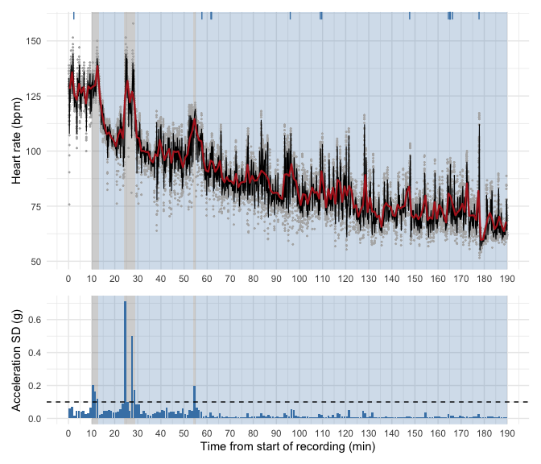

Figure 3: 3h10m recording. Grey areas: exercise bouts (acceleration SD
\> 0.1 g). Blue areas: recovery periods following each bout. Top:
beat-to-beat HR from RR intervals (grey points), device pulse (black)
and 1-min mean HR (red); lying positions are marked at the top (blue
ticks). Bottom: movement (SD of acceleration magnitude, 60-s windows);
dashed line = 0.1 g threshold.

</div>

What we observe:

- **Three exercise bouts** were detected: 10–13 min, 24–29 min (two
  close peaks) and 54–55 min. Each bout is followed by an increase in
  heart rate.
- **0–10 min:** heart rate is already high (125–140 bpm), although
  movement stays below the threshold. The participant was probably
  exercising with little trunk movement, which a chest accelerometer
  does not detect well. We therefore consider that the first bout covers
  0–13 min.
- **Recovery 1 (13–24 min):** heart rate falls steadily from about 135
  to 105 bpm, with little movement.
- **Recovery 2 (29–54 min):** heart rate falls to about 100 bpm and then
  stays on a plateau, while light movement continues. This is an active
  recovery.
- **Recovery 3 (55–190 min):** after the last bout, movement almost
  stops and heart rate decreases slowly from about 115 to 65 bpm over
  more than two hours, with short isolated peaks (possibly changes in
  body position).
- The body position signal is mostly `unknown`; lying positions appear
  only sporadically and do not help to define the phases.

For each recovery period, $t = 0$ is the end of the preceding exercise
bout.

### Fitting the models

We fitted four models to each recovery period separately, because each
period has a different heart rate pattern:

- **Linear:** $HR(t) = \beta_0 + \beta_1 t$
- **Mono-exponential:** $HR(t) = HR_\infty + a\,e^{-t/\tau}$
- **Bi-exponential:**
  $HR(t) = HR_\infty + a_1 e^{-t/\tau_1} + a_2 e^{-t/\tau_2}$
- **Mono-exponential + linear drift:**
  $HR(t) = HR_0 + a\,e^{-t/\tau} + b\,t$

where $HR_\infty$ is the plateau, $a$, $a_1$, $a_2$ the amplitudes of
the decrease and $\tau$, $\tau_1$, $\tau_2$ the time constants. For each
period, time is reset to zero at the end of the preceding exercise bout,
so that $t$ measures the time since the start of recovery.

The linear model was fitted with `lm()` and the exponential models by
non-linear least squares with `nls()`. Non-linear models need starting
values: we used the mean heart rate during the first 30 s to estimate
the initial heart rate and the median heart rate during the last 20 % of
the period to estimate the plateau; their difference gives an initial
estimate of the amplitude. We constrained amplitudes to be positive and
time constants to be at least 1 s.

The bi-exponential model has five parameters and is harder to fit. We
therefore tried three sets of starting values (the first one based on
the time constants reported by Joseph et al. (2023)) and kept the
converged fit with the smallest residual sum of squares, i.e. the
smallest overall difference between predicted and measured heart rates.

For each parameter, we report an approximate 95 % confidence interval
(estimate ± 1.96 × standard error). These intervals are only approximate
for non-linear models, and they are probably too narrow here because the
beat-to-beat residuals are autocorrelated (see the model comparison).

The fourth model was added because recovery 3 shows a fast initial
decrease followed by a slow, almost linear decline over several hours.
The bi-exponential model can follow this pattern, but its slow component
gives unrealistic parameter estimates (see below). Adding a linear drift
term describes this slow decrease without assuming that it is a second
exponential recovery process. We can then check whether this simpler
model, with one parameter less, fits the data as well as the
bi-exponential model. The same approach was used for the 7.5-min
recording (Section 04).

``` r
# ---------------------------------------------------------------
# 4a. Extract one recovery period and reset time to 0
# ---------------------------------------------------------------
# start_min / end_min come from the r3h_recoveries table (step 3).
# t becomes the time (s) since the END of the preceding exercise bout.
r3h_get_recovery <- function(start_min, end_min) {
  r3h_rr |>
    filter(t_min >= start_min, t_min <= end_min) |>   # keep this period only
    mutate(t = t - start_min * 60) |>                  # t = 0 at end of exercise
    select(t, hr)
}

# ---------------------------------------------------------------
# 4b. Fit the 3 models to one recovery period
# ---------------------------------------------------------------
r3h_fit_models <- function(d) {

  # Starting values estimated from the data themselves:
  hr_start <- mean(d$hr[d$t < 30])                    # mean HR in the first 30 s
  hr_end   <- median(d$hr[d$t > 0.8 * max(d$t)])      # median HR in the last 20 %
  amp      <- max(hr_start - hr_end, 1)               # size of the HR drop (bpm)

  # --- Linear model: HR = b0 + b1 * t
  linear <- lm(hr ~ t, data = d)

  # --- Mono-exponential: HR = hr_inf + a * exp(-t / tau)
  #     hr_inf = plateau, a = amplitude, tau = time constant (s)
  #     "port" algorithm allows bounds (a >= 0, tau >= 1 s)
  mono <- tryCatch(
    nls(hr ~ hr_inf + a * exp(-t / tau), data = d,
        start = list(hr_inf = hr_end, a = amp, tau = 60),
        algorithm = "port",
        lower = c(0, 0, 1), upper = c(200, 200, 1e5),
        control = list(maxiter = 500)),
    error = function(e) NULL)                          # NULL if it fails

  # --- Bi-exponential: HR = hr_inf + a1*exp(-t/tau1) + a2*exp(-t/tau2)
  #     Very sensitive to starting values -> we try several
  #     (first one inspired by Joseph et al. 2023: tau1 ~ 44 s, tau2 ~ 120 s)
  starts <- list(
    list(hr_inf = hr_end,      a1 = 0.6 * amp, tau1 = 40, a2 = 0.4 * amp, tau2 = 120),
    list(hr_inf = hr_end,      a1 = 0.5 * amp, tau1 = 60, a2 = 0.5 * amp, tau2 = 600),
    list(hr_inf = hr_end - 10, a1 = 0.5 * amp, tau1 = 60, a2 = 0.5 * amp, tau2 = 3000)
  )
  bi_fits <- map(starts, \(s) tryCatch(
    nls(hr ~ hr_inf + a1 * exp(-t / tau1) + a2 * exp(-t / tau2), data = d,
        start = s, algorithm = "port",
        lower = c(0, 0, 1, 0, 1), upper = c(200, 200, 1e4, 200, 1e5),
        control = list(maxiter = 500)),
    error = function(e) NULL))
  bi_fits <- compact(bi_fits)                          # remove failed fits
  # keep the fit with the smallest residual sum of squares (deviance)
  bi <- if (length(bi_fits) == 0) NULL else bi_fits[[which.min(map_dbl(bi_fits, deviance))]]

  list(linear = linear, mono = mono, bi = bi)
}

# ---------------------------------------------------------------
# 4c. Apply to the 3 recovery periods
# ---------------------------------------------------------------
# One row per recovery; "data" and "models" are list-columns
r3h_rec <- r3h_recoveries |>
  mutate(
    label  = paste0("Recovery ", bout, " (", start_min, "–", round(end_min), " min)"),
    data   = map2(start_min, end_min, r3h_get_recovery),   # the beats of each period
    models = map(data, r3h_fit_models)                     # the 3 fitted models
  )

# ---------------------------------------------------------------
# 4d. Table of fitted parameters (estimate + standard error + 95 % CI)
# ---------------------------------------------------------------
r3h_param_table <- function(m, model_name) {
  if (is.null(m)) return(NULL)                         # skip failed fits
  s <- summary(m)$coefficients
  tibble(model     = model_name,
         parameter = rownames(s),
         estimate  = s[, 1],
         SE        = s[, 2],
         CI_low    = s[, 1] - 1.96 * s[, 2],
         CI_high   = s[, 1] + 1.96 * s[, 2])
}

r3h_rec |>
  mutate(params = map(models, \(ms) imap(compact(ms), r3h_param_table) |> list_rbind())) |>
  select(label, params) |>
  unnest(params) |>
  knitr::kable(digits = 2, caption = "Fitted parameters for each recovery period (time in s)")
```

| label                   | model  | parameter   | estimate |      SE |  CI_low |  CI_high |
|:------------------------|:-------|:------------|---------:|--------:|--------:|---------:|
| Recovery 1 (13–24 min)  | linear | (Intercept) |   117.82 |    0.35 |  117.13 |   118.50 |
| Recovery 1 (13–24 min)  | linear | t           |    -0.02 |    0.00 |   -0.03 |    -0.02 |
| Recovery 1 (13–24 min)  | mono   | hr_inf      |   105.98 |    0.20 |  105.59 |   106.38 |
| Recovery 1 (13–24 min)  | mono   | a           |    26.61 |    0.68 |   25.29 |    27.94 |
| Recovery 1 (13–24 min)  | mono   | tau         |    90.63 |    4.27 |   82.25 |    99.01 |
| Recovery 2 (29–54 min)  | linear | (Intercept) |   100.33 |    0.30 |   99.73 |   100.93 |
| Recovery 2 (29–54 min)  | linear | t           |     0.00 |    0.00 |    0.00 |     0.00 |
| Recovery 2 (29–54 min)  | mono   | hr_inf      |    99.19 |    0.17 |   98.86 |    99.53 |
| Recovery 2 (29–54 min)  | mono   | a           |    11.10 |    1.20 |    8.74 |    13.45 |
| Recovery 2 (29–54 min)  | mono   | tau         |    86.43 |   14.39 |   58.22 |   114.64 |
| Recovery 2 (29–54 min)  | bi     | hr_inf      |    99.19 |    0.18 |   98.84 |    99.53 |
| Recovery 2 (29–54 min)  | bi     | a1          |     9.67 |    2.71 |    4.36 |    14.98 |
| Recovery 2 (29–54 min)  | bi     | tau1        |    95.17 |   27.14 |   41.98 |   148.36 |
| Recovery 2 (29–54 min)  | bi     | a2          |     4.63 |    3.96 |   -3.13 |    12.39 |
| Recovery 2 (29–54 min)  | bi     | tau2        |    10.08 |   16.97 |  -23.18 |    43.35 |
| Recovery 3 (55–190 min) | linear | (Intercept) |    93.12 |    0.16 |   92.80 |    93.44 |
| Recovery 3 (55–190 min) | linear | t           |     0.00 |    0.00 |    0.00 |     0.00 |
| Recovery 3 (55–190 min) | mono   | hr_inf      |    64.19 |    0.78 |   62.66 |    65.72 |
| Recovery 3 (55–190 min) | mono   | a           |    33.10 |    0.66 |   31.81 |    34.39 |
| Recovery 3 (55–190 min) | mono   | tau         |  4572.20 |  229.59 | 4122.20 |  5022.19 |
| Recovery 3 (55–190 min) | bi     | hr_inf      |    31.12 |   11.53 |    8.53 |    53.71 |
| Recovery 3 (55–190 min) | bi     | a1          |    20.61 |    0.98 |   18.68 |    22.53 |
| Recovery 3 (55–190 min) | bi     | tau1        |   173.88 |   15.30 |  143.89 |   203.87 |
| Recovery 3 (55–190 min) | bi     | a2          |    60.93 |   11.21 |   38.96 |    82.90 |
| Recovery 3 (55–190 min) | bi     | tau2        | 16436.08 | 4017.89 | 8561.02 | 24311.13 |

Fitted parameters for each recovery period (time in s)

``` r
# ---------------------------------------------------------------
# 4e. Fourth model: mono-exponential + linear drift
#     HR = hr0 + a * exp(-t / tau) + b * t
# ---------------------------------------------------------------
r3h_fit_drift <- function(d) {
  hr_start <- mean(d$hr[d$t < 30])
  hr_end   <- median(d$hr[d$t > 0.8 * max(d$t)])
  amp      <- max(hr_start - hr_end, 1)

  # try several starting values for tau, keep the best converged fit
  fits <- map(c(60, 120, 300), \(tau0) tryCatch(
    nls(hr ~ hr0 + a * exp(-t / tau) + b * t, data = d,
        start = list(hr0 = hr_end, a = amp, tau = tau0, b = 0),
        control = list(maxiter = 500)),
    error = function(e) NULL))
  fits <- compact(fits)
  if (length(fits) == 0) NULL else fits[[which.min(map_dbl(fits, deviance))]]
}

# Add this model to the list of models of each recovery
r3h_rec <- r3h_rec |>
  mutate(models = map2(models, data, \(ms, d)
                       c(ms, list(`mono + drift` = r3h_fit_drift(d)))))

# Parameters of the new model
r3h_rec |>
  mutate(params = map(models, \(ms) r3h_param_table(ms$`mono + drift`, "mono + drift"))) |>
  select(label, params) |>
  unnest(params) |>
  knitr::kable(digits = 3,
               caption = "Fitted parameters of the mono-exponential + linear drift model (time in s, b in bpm/s)")
```

| label                   | model        | parameter | estimate |     SE |  CI_low | CI_high |
|:------------------------|:-------------|:----------|---------:|-------:|--------:|--------:|
| Recovery 1 (13–24 min)  | mono + drift | hr0       |  100.429 |  1.782 |  96.937 | 103.921 |
| Recovery 1 (13–24 min)  | mono + drift | a         |   31.004 |  1.575 |  27.917 |  34.092 |
| Recovery 1 (13–24 min)  | mono + drift | tau       |  124.450 | 11.682 | 101.553 | 147.348 |
| Recovery 1 (13–24 min)  | mono + drift | b         |    0.010 |  0.003 |   0.004 |   0.016 |
| Recovery 3 (55–190 min) | mono + drift | hr0       |   90.721 |  0.198 |  90.334 |  91.109 |
| Recovery 3 (55–190 min) | mono + drift | a         |   21.331 |  0.899 |  19.568 |  23.094 |
| Recovery 3 (55–190 min) | mono + drift | tau       |  203.115 | 14.163 | 175.356 | 230.874 |
| Recovery 3 (55–190 min) | mono + drift | b         |   -0.003 |  0.000 |  -0.003 |  -0.003 |

Fitted parameters of the mono-exponential + linear drift model (time in
s, b in bpm/s)

``` r
# ---------------------------------------------------------------
# Predicted curves and observed data (same as before)
# ---------------------------------------------------------------
r3h_pred <- r3h_rec |>
  mutate(pred = map2(data, models, \(d, ms) {
    grid <- tibble(t = seq(0, max(d$t), length.out = 500))
    imap(compact(ms), \(m, name)
         mutate(grid, model = name, hr = predict(m, newdata = grid))) |>
      list_rbind()
  })) |>
  select(bout, pred) |>
  unnest(pred)

r3h_obs <- r3h_rec |>
  select(bout, data) |>
  unnest(data)

r3h_model_colours <- c(linear = "#1b9e77", mono = "#7570b3", bi = "#d95f02")
r3h_model_colours4 <- c(r3h_model_colours, `mono + drift` = "#e7298a")

# ---------------------------------------------------------------
# Function: plot one recovery period
#   i       = number of the recovery (1, 2 or 3)
#   max_min = optional: only show the first max_min minutes (zoom)
# ---------------------------------------------------------------
r3h_plot_recovery <- function(i, max_min = Inf) {
  rec <- r3h_rec[r3h_rec$bout == i, ]                       # info on this recovery
  obs <- filter(r3h_obs,  bout == i, t <= max_min * 60)     # its data
  prd <- filter(r3h_pred, bout == i, t <= max_min * 60)     # its fitted curves

  ggplot(obs, aes(t / 60, hr)) +
    geom_point(colour = "grey60", size = 0.6, alpha = 0.4) +
    geom_line(data = prd, aes(colour = model), linewidth = 1.1) +
    scale_colour_manual(values = r3h_model_colours4,
                        breaks = c("linear", "mono", "bi", "mono + drift"),
                        labels = c("Linear", "Mono-exponential",
                                   "Bi-exponential", "Mono-exp. + drift")) +
    labs(title = paste0("Recovery ", i, " (",
                        rec$start_min, "–", round(rec$end_min), " min of the recording)",
                        # add ": first 20 min" only when we zoom
                        if (is.finite(max_min)) paste0(": first ", max_min, " min") else ""),
         x = "Time since end of exercise (min)", y = "Heart rate (bpm)",
         colour = NULL) +
    theme_minimal(base_size = 12) +
    theme(legend.position = "bottom",
          plot.title = element_text(face = "bold"))
}
```

``` r
r3h_plot_recovery(1)
```

<div id="fig-r3h-rec1">

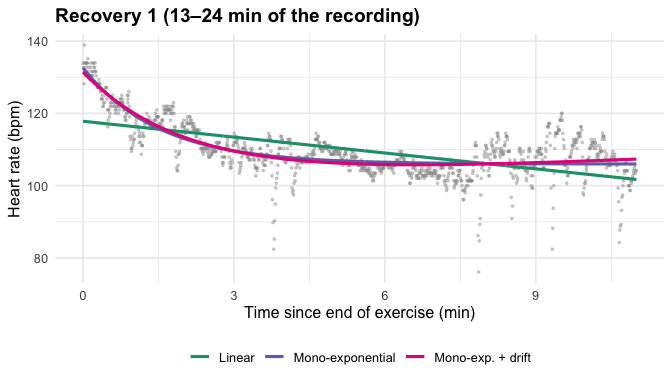

Figure 4: Recovery 1 (after the first exercise bout): linear,
mono-exponential, bi-exponential and mono-exponential + drift fits

</div>

``` r
r3h_plot_recovery(2)
```

<div id="fig-r3h-rec2">

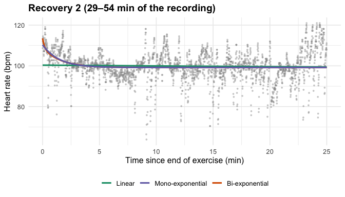

Figure 5: Recovery 2: Linear, mono-exponential and bi-exponential model
fits

</div>

``` r
r3h_plot_recovery(3)
```

<div id="fig-r3h-rec3">

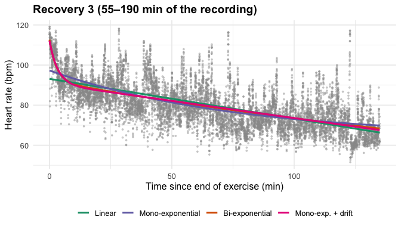

Figure 6: Recovery 3 (after the last exercise bout, until the end of the
recording): linear, mono-exponential, bi-exponential and
mono-exponential + drift fits

</div>

``` r
r3h_plot_recovery(3, max_min = 20)
```

<div id="fig-r3h-rec3-zoom">

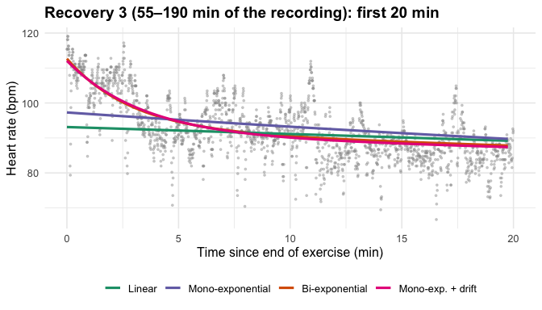

Figure 7: Zoom on the first 20 min of recovery 3 : linear,
mono-exponential, bi-exponential and mono-exponential + drift fits

</div>

**Recovery 1 (13–24 min,
<a href="#fig-r3h-rec1" class="quarto-xref">Figure 4</a>).** The
mono-exponential model gives a time constant $\tau \approx 91$ s (95 %
CI: 82–99 s), an amplitude of about 27 bpm and a plateau of about 106
bpm. These parameters are precise and physiologically plausible. The
linear model misses the fast decrease at the beginning of recovery. The
bi-exponential model did not converge, which suggests that the data do
not contain enough information to estimate two distinct time constants
over this short period. The mono-exponential + drift model is almost
identical to the mono-exponential model: its drift term adds very little
over this short period.

**Recovery 2 (29–54 min,
<a href="#fig-r3h-rec2" class="quarto-xref">Figure 5</a>).** The
decrease in heart rate is small (amplitude of about 11 bpm) and heart
rate quickly stabilises around 99 bpm, consistent with the light
movement that continues during this period (active recovery). The
mono-exponential time constant ($\tau \approx 86$ s) is estimated with a
wide confidence interval (58–115 s). The bi-exponential model converged
but is not interpretable: its second time constant is shorter than the
first one and the confidence interval of its amplitude includes negative
values. The two exponential components cannot be separated. The
mono-exponential + drift model did not converge.

**Recovery 3 (55–190 min,
<a href="#fig-r3h-rec3" class="quarto-xref">Figure 6</a> and
<a href="#fig-r3h-rec3-zoom" class="quarto-xref">Figure 7</a>).** This
is the longest and calmest recovery period. Two processes are visible: a
fast decrease in heart rate during the first minutes, then a very slow
decrease over more than two hours.

- The mono-exponential model only captures the slow decrease
  ($\tau \approx 4\,570$ s, i.e. about 76 min, plateau ≈ 64 bpm). It
  misses the fast initial drop: its curve starts at about 97 bpm,
  whereas the observed heart rate is about 112 bpm
  (<a href="#fig-r3h-rec3-zoom" class="quarto-xref">Figure 7</a>).
- The bi-exponential model follows both phases. Its fast component
  ($\tau_1 \approx 174$ s, i.e. about 3 min; amplitude ≈ 21 bpm)
  describes the early recovery. However, its slow component is not
  physiologically interpretable: $\tau_2 \approx 16\,400$ s (about 4.5
  h, longer than the recording itself) and the plateau
  ($HR_\infty \approx 31$ bpm) is far below any plausible resting heart
  rate. When $\tau_2$ is much longer than the observation window,
  $a_2 e^{-t/\tau_2}$ behaves like a straight line: the “slow phase” is
  in fact a linear drift of about 0.2 bpm/min. The same behaviour was
  observed on the 7.5-min recording. Accordingly, the mono-exponential +
  drift model gives a curve that is almost indistinguishable from the
  bi-exponential one
  (<a href="#fig-r3h-rec3-zoom" class="quarto-xref">Figure 7</a>).

The time constants of the fast phase (91 s for recovery 1, 174 s for
recovery 3) are of the same order of magnitude as those reported in the
literature, although longer than the 44–65 s found by Joseph et al.
(2023) after a maximal test with supine recovery. The intensity of
exercise in our recording is unknown, and recovery took place without
controlled posture, which may explain part of this difference. The
models are compared quantitatively in the next section.

### Model comparison and residual analysis

We compare the fitted models to determine which one best describes heart
rate recovery. We use several indicators, because a model can fit the
data well but still be too complex or miss important patterns.

**Goodness of fit.** We compute the mean absolute error (MAE, the
average distance between the model and the measured heart rate), the
root mean square error (RMSE, which gives more weight to large errors)
and $R^2$ (the proportion of the heart rate variation explained by the
model). Lower MAE and RMSE and higher $R^2$ indicate a better fit. The
signed mean error is not used: it is always close to zero, because
least-squares fitting balances positive and negative errors.

**Complexity.** The Akaike and Bayesian information criteria (AIC, BIC)
take into account both the fit and the number of parameters. Lower
values are better: when two models fit the data similarly well, the
simpler one is preferred. We report $\Delta AIC$, the difference from
the best model of each recovery period.

**Residuals.** The residuals are the differences between the measured
and the predicted heart rate. A good model leaves residuals that are
randomly scattered around zero. We examine them over time to detect
systematic errors (long periods during which the model is always above
or below the data). We also test whether consecutive residuals are
independent, using the Durbin–Watson statistic (close to 2 for
independent residuals), the lag-1 autocorrelation and the Ljung–Box
test.

``` r
# ---------------------------------------------------------------
# 5b. Indicators of goodness of fit and residual structure
# ---------------------------------------------------------------
r3h_indicators <- function(models, d) {
  imap(compact(models), \(m, name) {
    e <- resid(m)                                       # residuals
    tibble(
      model      = name,
      k          = length(coef(m)),                     # number of parameters
      RMSE       = sqrt(mean(e^2)),                     # typical error (bpm)
      R2         = 1 - sum(e^2) / sum((d$hr - mean(d$hr))^2),
      AIC        = AIC(m),                              # lower = better
      BIC        = BIC(m),                              # lower = better (penalises k more)
      DW         = sum(diff(e)^2) / sum(e^2),           # Durbin-Watson: 2 = independent
      acf_lag1   = acf(e, plot = FALSE)$acf[2],         # correlation with previous residual
      LjungBox_p = Box.test(e, lag = 10, type = "Ljung-Box")$p.value
    )
  }) |>
    list_rbind() |>
    mutate(dAIC = AIC - min(AIC), .after = AIC)         # difference with the best model
}

r3h_ind <- r3h_rec |>
  mutate(ind = map2(models, data, r3h_indicators)) |>
  select(label, ind) |>
  unnest(ind)

knitr::kable(r3h_ind, digits = c(0, 0, 0, 2, 3, 0, 0, 0, 2, 2, 3),
             caption = "Model comparison for each recovery period")
```

| label | model | k | RMSE | R2 | AIC | dAIC | BIC | DW | acf_lag1 | LjungBox_p |
|:---|:---|---:|---:|---:|---:|---:|---:|---:|---:|---:|
| Recovery 1 (13–24 min) | linear | 2 | 6.20 | 0.366 | 7792 | 706 | 7807 | 0.10 | 0.95 | 0 |
| Recovery 1 (13–24 min) | mono | 3 | 4.64 | 0.645 | 7099 | 13 | 7120 | 0.17 | 0.91 | 0 |
| Recovery 1 (13–24 min) | mono + drift | 4 | 4.62 | 0.649 | 7086 | 0 | 7111 | 0.17 | 0.91 | 0 |
| Recovery 2 (29–54 min) | linear | 2 | 7.62 | 0.001 | 17028 | 140 | 17045 | 0.15 | 0.93 | 0 |
| Recovery 2 (29–54 min) | mono | 3 | 7.41 | 0.057 | 16888 | 0 | 16911 | 0.16 | 0.92 | 0 |
| Recovery 2 (29–54 min) | bi | 5 | 7.40 | 0.058 | 16890 | 2 | 16925 | 0.16 | 0.92 | 0 |
| Recovery 3 (55–190 min) | linear | 2 | 8.75 | 0.441 | 75759 | 864 | 75781 | 0.15 | 0.93 | 0 |
| Recovery 3 (55–190 min) | mono | 3 | 8.61 | 0.459 | 75403 | 507 | 75432 | 0.15 | 0.92 | 0 |
| Recovery 3 (55–190 min) | bi | 5 | 8.40 | 0.485 | 74896 | 0 | 74939 | 0.16 | 0.92 | 0 |
| Recovery 3 (55–190 min) | mono + drift | 4 | 8.41 | 0.484 | 74911 | 15 | 74947 | 0.16 | 0.92 | 0 |

Model comparison for each recovery period

``` r
# Nice names for the models (used as panel titles)
r3h_model_names <- c(linear = "Linear", mono = "Mono-exponential",
                     bi = "Bi-exponential", `mono + drift` = "Mono-exp. + drift")

# ---------------------------------------------------------------
# 5c. Residuals of every model, for every recovery
# ---------------------------------------------------------------
r3h_res <- r3h_rec |>
  mutate(res = map2(models, data, \(ms, d)
                    imap(compact(ms), \(m, name)
                         tibble(model = name, t = d$t, resid = resid(m))) |>
                      list_rbind())) |>
  select(bout, label, res) |>
  unnest(res) |>
  mutate(model = factor(model, levels = c("linear", "mono", "bi", "mono + drift")))

# ---------------------------------------------------------------
# Function: by how much is the model above (+) or below (-) the real HR?
#   One small panel per model, values averaged in bins of bin_s seconds
# ---------------------------------------------------------------
r3h_plot_sign <- function(i, bin_s = 20, max_min = Inf) {
  d <- r3h_res |>
    filter(bout == i, t <= max_min * 60) |>
    # mean residual in each time bin (removes beat-to-beat noise)
    group_by(model, t = floor(t / bin_s) * bin_s + bin_s / 2) |>
    summarise(resid = mean(resid), .groups = "drop") |>
    # residual = real HR - model, so model - real HR = -residual
    #   e.g. model 10 bpm above the real HR -> +10
    mutate(error    = -resid,
           position = if_else(error > 0, "Model above real HR", "Model below real HR"))

  ggplot(d, aes(t / 60, error, fill = position)) +
    geom_col(width = bin_s / 60) +                     # one bar per time bin
    geom_hline(yintercept = 0) +
    facet_wrap(~model, ncol = 1, labeller = as_labeller(r3h_model_names)) +
    scale_fill_manual(values = c("Model above real HR" = "firebrick",
                                 "Model below real HR" = "steelblue")) +
    labs(x = "Time since end of exercise (min)",
         y = "Model − real HR (bpm)", fill = NULL) +
    theme_minimal(base_size = 11) +
    theme(legend.position = "bottom",
          strip.text = element_text(face = "bold"),
          panel.grid.minor = element_blank())
}

# ---------------------------------------------------------------
# Function: HR + fitted models (top) and sign panels (bottom)
# ---------------------------------------------------------------
r3h_plot_fit_sign <- function(i, bin_s = 20, max_min = Inf) {
  top    <- r3h_plot_recovery(i, max_min) + labs(x = NULL)
  bottom <- r3h_plot_sign(i, bin_s, max_min)
  patchwork::wrap_plots(top, bottom, ncol = 1, heights = c(1.5, 3))   # bottom = 2x taller
}
```

``` r
r3h_plot_fit_sign(1, bin_s = 20)
```

<div id="fig-r3h-res1">

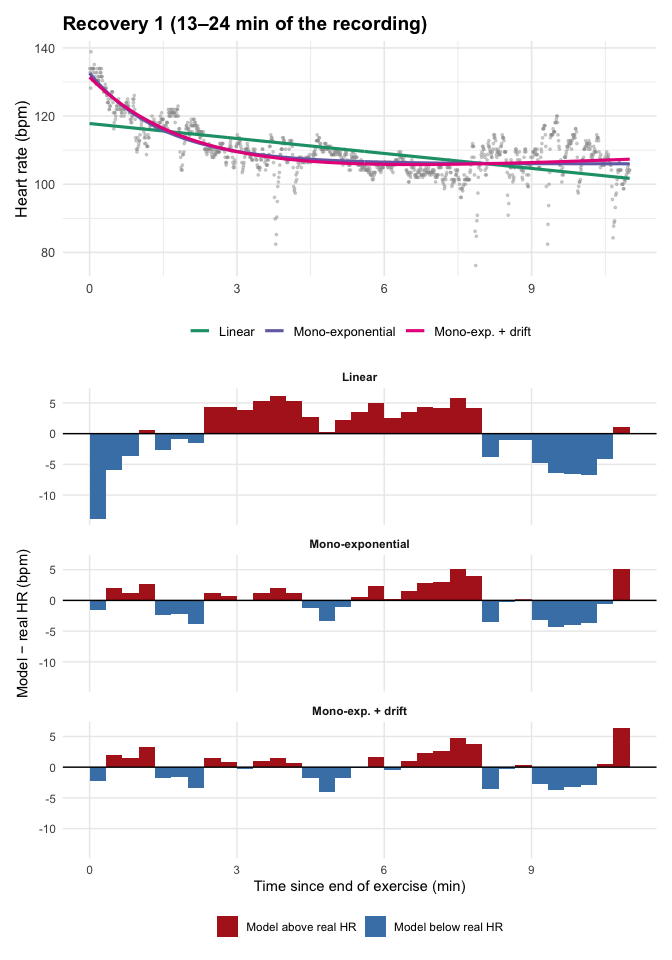

Figure 8: Recovery 1. Top: heart rate and fitted models. Bottom: for
each model, difference between the model and the real heart rate (bpm,
20-s bins); positive = model above the real heart rate. Long blocks of
the same sign indicate a systematic error.

</div>

``` r
r3h_plot_fit_sign(2, bin_s = 30)
```

<div id="fig-r3h-res2">

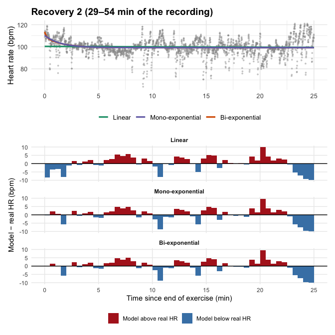

Figure 9: Recovery 2. Top: heart rate and fitted models. Bottom:
difference between the model and the real heart rate for each model
(bpm) (30-s bins).

</div>

``` r
r3h_plot_fit_sign(3, bin_s = 120)
```

<div id="fig-r3h-res3">

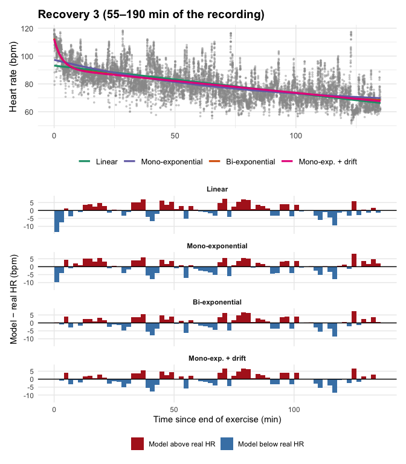

Figure 10: Recovery 3. Top: heart rate and fitted models. Bottom:
difference between the model and the real heart rate for each model
(bpm) (2-min bins).

</div>

``` r
r3h_plot_fit_sign(3, bin_s = 20, max_min = 20)
```

<div id="fig-r3h-res3-zoom">

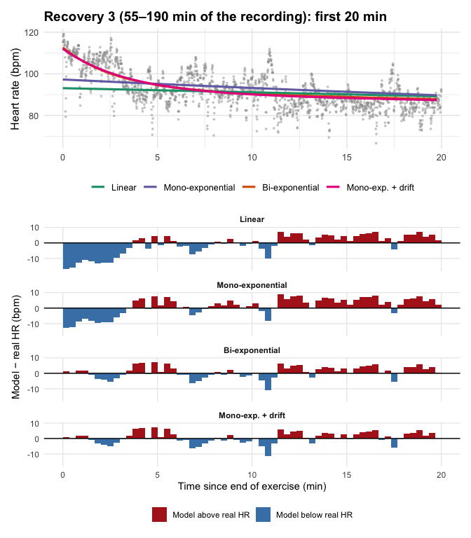

Figure 11: First 20 min of recovery 3. Top: heart rate and fitted
models. Bottom: difference between the model and the real heart rate for
each model (bpm) (20-s bins).

</div>

``` r
# ---------------------------------------------------------------
# 5e. Final summary: how far is each model from the real HR, on average?
# ---------------------------------------------------------------
r3h_summary <- r3h_res |>
  mutate(model = as.character(model)) |>
  group_by(bout, label, model) |>
  summarise(
    mean_error = mean(-resid),          # signed mean (≈ 0: errors cancel out)
    MAE        = mean(abs(resid)),      # mean absolute error (bpm)
    RMSE       = sqrt(mean(resid^2)),   # penalises large errors more
    .groups = "drop"
  ) |>
  # add the number of parameters and ΔAIC from the comparison table
  left_join(select(r3h_ind, label, model, k, dAIC), by = c("label", "model")) |>
  # best model of each recovery = lowest AIC (ΔAIC = 0)
  mutate(best = if_else(dAIC == 0, "best (AIC)", ""),
         model = factor(model, levels = c("linear", "mono", "bi", "mono + drift"))) |>
  arrange(bout, model)

r3h_summary |>
  select(label, model, k, mean_error, MAE, RMSE, dAIC, best) |>
  knitr::kable(digits = 2,
               col.names = c("Recovery", "Model", "Parameters", "Mean error (bpm)",
                             "MAE (bpm)", "RMSE (bpm)", "ΔAIC", ""),
               caption = "Summary of model performance for each recovery period")
```

| Recovery | Model | Parameters | Mean error (bpm) | MAE (bpm) | RMSE (bpm) | ΔAIC |  |
|:---|:---|---:|---:|---:|---:|---:|:---|
| Recovery 1 (13–24 min) | linear | 2 | 0 | 4.86 | 6.20 | 705.77 |  |
| Recovery 1 (13–24 min) | mono | 3 | 0 | 3.35 | 4.64 | 13.37 |  |
| Recovery 1 (13–24 min) | mono + drift | 4 | 0 | 3.31 | 4.62 | 0.00 | best (AIC) |
| Recovery 2 (29–54 min) | linear | 2 | 0 | 5.58 | 7.62 | 139.97 |  |
| Recovery 2 (29–54 min) | mono | 3 | 0 | 5.31 | 7.41 | 0.00 | best (AIC) |
| Recovery 2 (29–54 min) | bi | 5 | 0 | 5.31 | 7.40 | 2.31 |  |
| Recovery 3 (55–190 min) | linear | 2 | 0 | 6.79 | 8.75 | 863.74 |  |
| Recovery 3 (55–190 min) | mono | 3 | 0 | 6.70 | 8.61 | 507.30 |  |
| Recovery 3 (55–190 min) | bi | 5 | 0 | 6.45 | 8.40 | 0.00 | best (AIC) |
| Recovery 3 (55–190 min) | mono + drift | 4 | 0 | 6.45 | 8.41 | 15.30 |  |

Summary of model performance for each recovery period

``` r
ggplot(r3h_summary, aes(model, MAE, fill = model)) +
  geom_col() +
  # star above the best model (lowest AIC)
  geom_text(data = filter(r3h_summary, best != ""),
            aes(label = "best"), vjust = -0.3, size = 4) +
  facet_wrap(~label, nrow = 1) +
  scale_fill_manual(values = r3h_model_colours4, labels = r3h_model_names) +
  scale_x_discrete(labels = r3h_model_names) +
  scale_y_continuous(expand = expansion(mult = c(0, 0.15))) +   # room for the label
  labs(x = NULL, y = "Mean absolute error (bpm)", fill = NULL) +
  theme_minimal(base_size = 12) +
  theme(legend.position = "none",
        axis.text.x = element_text(angle = 30, hjust = 1),
        strip.text = element_text(face = "bold"))
```

<div id="fig-r3h-summary">

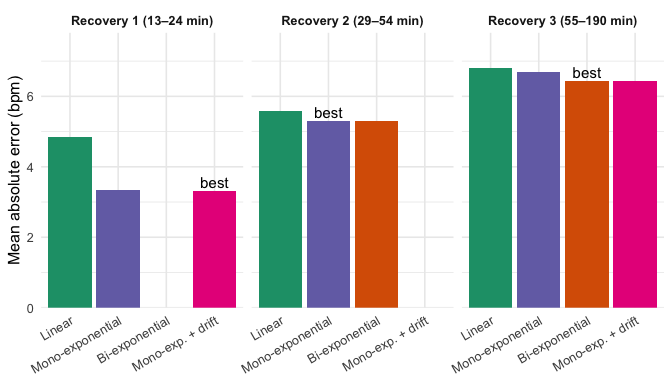

Figure 12: Mean absolute error (MAE) of each model for each recovery
period. The best model according to AIC is labelled ‘best’.

</div>

The BIC gives the same ranking as the AIC for all recovery periods.

**Recovery 1 (13–24 min).** The linear model is clearly rejected
($\Delta AIC \approx 706$, $R^2 = 0.37$). Its residuals show a
systematic pattern: it underestimates heart rate by about 13 bpm at the
start of recovery, then overestimates it for several minutes
(<a href="#fig-r3h-res1" class="quarto-xref">Figure 8</a>). The
mono-exponential model reduces the MAE from 4.9 to 3.4 bpm, increases
$R^2$ to 0.65, and its errors alternate around zero. The
mono-exponential + drift model has the lowest AIC, but its improvement
is negligible in practice (MAE 3.31 vs 3.35 bpm, same $R^2$). We
therefore retain the mono-exponential model as the most parsimonious and
interpretable description of this recovery ($\tau \approx 91$ s). The
bi-exponential model did not converge.

**Recovery 2 (29–54 min).** All models perform similarly (MAE 5.3–5.6
bpm) and show the same residual pattern
(<a href="#fig-r3h-res2" class="quarto-xref">Figure 9</a>). All models
explain almost none of the heart rate variation during this period
($R^2 \le 0.06$). The mono-exponential model has the lowest AIC; the
bi-exponential model, with two extra parameters, does not improve the
fit ($\Delta AIC \approx 2$, identical MAE). The residual waves are not
explained by any decay model: they follow the changes in movement during
this active recovery. The mono-exponential + drift model did not
converge.

**Recovery 3 (55–190 min).** The linear and mono-exponential models both
miss the fast decrease at the beginning of recovery: during the first 4
min, they underestimate heart rate by up to 10–15 bpm
(<a href="#fig-r3h-res3-zoom" class="quarto-xref">Figure 11</a>). The
bi-exponential and mono-exponential + drift models capture this fast
phase and give the same MAE (6.45 bpm) and nearly the same $R^2$ (0.485
and 0.484). The bi-exponential model has the lowest AIC, but its slow
component is not physiologically interpretable ($\tau_2 \approx 4.5$ h,
$HR_\infty \approx 31$ bpm, see previous section). The
mono-exponential + drift model reaches the same accuracy with one
parameter less, which confirms that the “slow phase” of the
bi-exponential model mainly describes a linear drift.

**Limits of the statistical comparison.** For all models and all
recovery periods, the residuals are strongly autocorrelated: the
Durbin–Watson statistic ranges from 0.10 to 0.17 (far below the value of
2 expected for independent residuals), the lag-1 autocorrelation ranges
from 0.91 to 0.95, and the Ljung–Box test is highly significant
($p \approx 0$). Beat-to-beat heart rate fluctuates with breathing and
with changes in movement, which no smooth decay curve can capture. With
thousands of correlated beats, the AIC differences overstate the
evidence and should be read as indicative. The choice of model must
therefore also rely on residual structure, parsimony and physiological
interpretability.

**In summary**, the post-exercise decrease in heart rate is well
described by a mono-exponential decay with a time constant of about
1.5–3 min. On the long recovery, this fast phase is followed by a slow,
almost linear drift over several hours, which reflects prolonged rest
rather than a second exponential recovery process.

### Sensitivity analyses

We use sensitivity analyses to check whether our results change when the
data are analysed differently. The goal is to see whether our
conclusions remain the same when we change the length of the analysed
window or the signal used.

**Window length.** On recovery 3, the longest recovery period, we fit
the models over the first 5, 10, 20 and 60 min after the end of
exercise, and over the whole recovery (about 135 min). This tests
whether the estimated time constants describe the recovery itself or
depend on how long we observe heart rate after exercise.

**Signal.** We compare three heart rate signals: beat-to-beat heart rate
from RR intervals, heart rate averaged in 5-s bins, and the pulse signal
computed by the device (about one value every 5 s). Averaging in 5-s
bins reduces the small beat-to-beat fluctuations and makes the RR data
comparable with the pulse signal. It also strongly reduces the number of
points and their autocorrelation, which allows us to check whether the
large AIC differences obtained with beat-to-beat data are inflated. This
comparison is done on the first 20 min of recovery 3 and on the whole of
recoveries 1 and 2 (the pulse signal is only used for recovery 3).

``` r
# ---------------------------------------------------------------
# 6a. Data sets to test
# ---------------------------------------------------------------
r3h_rec1 <- r3h_rec$data[[1]]                 # recovery 1 (RR), already prepared
r3h_rec3 <- r3h_rec$data[[3]]                 # recovery 3 (RR), already prepared
r3h_start3 <- r3h_rec$start_min[3]            # start of recovery 3 (min)

# Mean HR in 5-s bins (reduces beat-to-beat noise)
r3h_bin5 <- function(d) {
  d |>
    group_by(t = floor(t / 5) * 5 + 2.5) |>
    summarise(hr = mean(hr), .groups = "drop")
}

# Device pulse during recovery 3, with t = 0 at the end of exercise
r3h_pulse3 <- r3h_pulse |>
  filter(t_min >= r3h_start3) |>
  mutate(t = t - r3h_start3 * 60) |>
  select(t, hr)

# All the data sets we want to compare (t is in seconds)
r3h_sens <- list(
  "R3, first 5 min (RR)"        = filter(r3h_rec3, t <= 5 * 60),
  "R3, first 10 min (RR)"       = filter(r3h_rec3, t <= 10 * 60),
  "R3, first 20 min (RR)"       = filter(r3h_rec3, t <= 20 * 60),
  "R3, first 60 min (RR)"       = filter(r3h_rec3, t <= 60 * 60),
  "R3, whole (RR)"              = r3h_rec3,
  "R3, first 20 min (5-s bins)" = r3h_bin5(filter(r3h_rec3, t <= 20 * 60)),
  "R3, first 20 min (pulse)"    = filter(r3h_pulse3, t <= 20 * 60),
  "R1, whole (RR)"              = r3h_rec1,
  "R1, whole (5-s bins)"        = r3h_bin5(r3h_rec1),
  "R1, whole (5-s bins)"        = r3h_bin5(r3h_rec1),
  "R2, whole (RR)"              = r3h_rec$data[[2]],
  "R2, whole (5-s bins)"        = r3h_bin5(r3h_rec$data[[2]])
)

# ---------------------------------------------------------------
# 6b. Fit the 3 models to one data set and keep the key results
# ---------------------------------------------------------------
r3h_sens_row <- function(d, name) {
  ms <- r3h_fit_models(d)                     # same function as in step 4

  # small helpers that return NA when a model did not converge
  get_coef <- function(m, p) if (is.null(m)) NA_real_ else coef(m)[[p]]
  get_se   <- function(m, p) if (is.null(m)) NA_real_ else summary(m)$coefficients[p, 2]
  get_aic  <- function(m)    if (is.null(m)) NA_real_ else AIC(m)

  tibble(
    data          = name,
    n             = nrow(d),
    tau_mono      = get_coef(ms$mono, "tau"),                        # s
    tau_low       = tau_mono - 1.96 * get_se(ms$mono, "tau"),        # 95 % CI
    tau_high      = tau_mono + 1.96 * get_se(ms$mono, "tau"),
    hr_inf_mono   = get_coef(ms$mono, "hr_inf"),                     # plateau (bpm)
    tau1_bi       = get_coef(ms$bi, "tau1"),                         # fast (s)
    tau2_bi       = get_coef(ms$bi, "tau2"),                         # slow (s)
    dAIC_lin_mono = get_aic(ms$linear) - get_aic(ms$mono),           # > 0: mono better
    dAIC_mono_bi  = get_aic(ms$mono)   - get_aic(ms$bi)              # > 0: bi better
  )
}

# ---------------------------------------------------------------
# 6c. Run on all data sets and show the table
# ---------------------------------------------------------------
r3h_sens_tab <- imap(r3h_sens, r3h_sens_row) |> list_rbind()

knitr::kable(r3h_sens_tab, digits = 1,
             col.names = c("Data", "n", "τ mono (s)", "CI low", "CI high",
                           "HR∞ mono (bpm)", "τ1 bi (s)", "τ2 bi (s)",
                           "AIC linear − mono", "AIC mono − bi"),
             caption = "Sensitivity of the results to the time window and to the signal used")
```

| Data | n | τ mono (s) | CI low | CI high | HR∞ mono (bpm) | τ1 bi (s) | τ2 bi (s) | AIC linear − mono | AIC mono − bi |
|:---|---:|---:|---:|---:|---:|---:|---:|---:|---:|
| R3, first 5 min (RR) | 499 | 1417.2 | -3299.8 | 6134.2 | 0.0 | NA | NA | -6.9 | NA |
| R3, first 10 min (RR) | 958 | 173.5 | 139.0 | 208.1 | 90.7 | NA | NA | 135.5 | NA |
| R3, first 20 min (RR) | 1825 | 330.1 | 287.8 | 372.3 | 85.6 | 138.2 | 9506.1 | 234.9 | 28.9 |
| R3, first 60 min (RR) | 5134 | 548.6 | 499.4 | 597.8 | 83.5 | 191.9 | 29906.2 | 478.1 | 198.1 |
| R3, whole (RR) | 10555 | 4572.2 | 4122.2 | 5022.2 | 64.2 | 173.9 | 16436.1 | 356.4 | 507.3 |
| R3, first 20 min (5-s bins) | 240 | 326.5 | 227.5 | 425.6 | 85.4 | 137.9 | 9770.3 | 38.8 | 1.9 |
| R3, first 20 min (pulse) | 269 | 380.2 | 265.2 | 495.2 | 84.1 | 124.9 | 8608.8 | 35.9 | 6.1 |
| R1, whole (RR) | 1200 | 90.6 | 82.3 | 99.0 | 106.0 | NA | NA | 692.4 | NA |
| R1, whole (5-s bins) | 132 | 90.9 | 68.5 | 113.4 | 105.8 | 90.9 | 90.9 | 89.5 | -4.0 |
| R1, whole (5-s bins) | 132 | 90.9 | 68.5 | 113.4 | 105.8 | 90.9 | 90.9 | 89.5 | -4.0 |
| R2, whole (RR) | 2467 | 86.4 | 58.2 | 114.6 | 99.2 | 95.2 | 10.1 | 140.0 | -2.3 |
| R2, whole (5-s bins) | 300 | 92.8 | 20.2 | 165.4 | 98.7 | NA | NA | 21.6 | NA |

Sensitivity of the results to the time window and to the signal used

``` r
# Recovery 3 windows fitted with RR intervals
r3h_win <- r3h_sens_tab |>
  filter(str_starts(data, "R3"), str_ends(data, "\\(RR\\)")) |>
  mutate(window_min = c(5, 10, 20, 60, round(max(r3h_rec3$t) / 60))) |>
  filter(window_min > 5)                       # 5 min: no plateau, not interpretable

# The 3 time constants in one long table
r3h_win_long <- bind_rows(
  r3h_win |> transmute(window_min, tau = tau_mono, low = tau_low, high = tau_high,
                       type = "Mono-exponential τ"),
  r3h_win |> transmute(window_min, tau = tau1_bi, low = NA, high = NA,
                       type = "Bi-exponential τ1 (fast)"),
  r3h_win |> transmute(window_min, tau = tau2_bi, low = NA, high = NA,
                       type = "Bi-exponential τ2 (slow)")
) |>
  filter(!is.na(tau))

r3h_tau_types <- c("Mono-exponential τ", "Bi-exponential τ1 (fast)", "Bi-exponential τ2 (slow)")

ggplot(r3h_win_long, aes(window_min, tau, colour = type, linetype = type)) +
  # grey dotted line: tau = window length
  geom_line(data = tibble(window_min = c(10, 135), tau = c(10, 135) * 60),
            aes(window_min, tau), inherit.aes = FALSE,
            colour = "grey60", linetype = "dotted", linewidth = 0.8) +
  annotate("text", x = 40, y = 40 * 60 * 1.4, label = "τ = window length",
           colour = "grey50", angle = 18, size = 3.5) +
  geom_line(linewidth = 1) +
  geom_point(size = 2.5) +
  geom_errorbar(aes(ymin = low, ymax = high), width = 0.05, na.rm = TRUE) +
  scale_x_log10(breaks = c(10, 20, 60, 135)) +
  scale_y_log10(breaks = c(60, 180, 600, 1800, 3600, 3 * 3600, 8 * 3600),
                labels = c("1 min", "3 min", "10 min", "30 min", "1 h", "3 h", "8 h")) +
  scale_colour_manual(breaks = r3h_tau_types,
                      values = c("#7570b3", "#d95f02", "#d95f02")) +
  scale_linetype_manual(breaks = r3h_tau_types,
                        values = c("solid", "solid", "dashed")) +
  labs(title = "Effect of the window length (recovery 3)",
       x = "Window analysed after the end of exercise (min)",
       y = "Time constant", colour = NULL, linetype = NULL) +
  theme_minimal(base_size = 12) +
  theme(legend.position = "bottom", plot.title = element_text(face = "bold"))
```

<div id="fig-r3h-sensitivity">

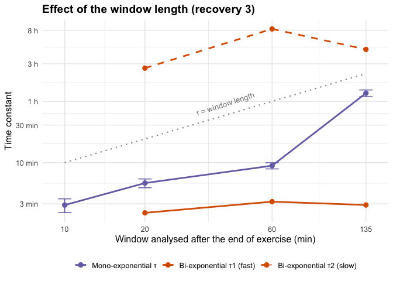

Figure 13: Time constants estimated on recovery 3 for increasing window
lengths (log scales). The mono-exponential τ increases with the window,
whereas the fast bi-exponential τ1 stays around 3 min. The slow τ2 is
always above the grey line, i.e. longer than the window itself. The
5-min window is not shown (no plateau could be estimated).

</div>

On recovery 3, the mono-exponential time constant increases strongly
with the window
(<a href="#fig-r3h-sensitivity" class="quarto-xref">Figure 13</a>): from
174 s (about 3 min) over the first 10 min, to 330 s over 20 min, 549 s
over 60 min and 4 572 s (about 1.3 h) over the whole recovery. The
longer the window, the more the mono-exponential model absorbs the slow
drift of heart rate, so its time constant no longer describes the
post-exercise recovery itself. Over the first 5 min only (not shown),
the model cannot identify a plateau ($HR_\infty$ stuck at 0, confidence
interval of $\tau$ including negative values) and the linear model fits
better: this window is too short.

In contrast, the fast time constant of the bi-exponential model is
stable: whenever the model converges, $\tau_1$ stays between 138 and 192
s, i.e. about 3 min, which matches the mono-exponential $\tau$ obtained
over the first 10 min. The slow time constant $\tau_2$ ranges from about
2.4 to 8 h and is always above the grey line, i.e. longer than the
window itself. It therefore never describes a real exponential phase,
only a slow linear drift. As a consequence, the advantage of the
bi-exponential model over the mono-exponential model grows with the
window length ($\Delta AIC$ from 29 over 20 min to 507 over the whole
recovery), because this drift accumulates over time.

``` r
r3h_sig <- r3h_sens_tab |>
  filter(data %in% c("R3, first 20 min (RR)", "R3, first 20 min (5-s bins)",
                     "R3, first 20 min (pulse)", "R1, whole (RR)", "R1, whole (5-s bins)",
                     "R2, whole (RR)", "R2, whole (5-s bins)")) |>
  mutate(recovery = case_when(str_starts(data, "R1") ~ "Recovery 1 (whole)",
                              str_starts(data, "R2") ~ "Recovery 2 (whole)",
                              str_starts(data, "R3") ~ "Recovery 3 (first 20 min)"),
         signal   = case_when(str_detect(data, "\\(RR\\)") ~ "RR intervals",
                              str_detect(data, "5-s bins") ~ "5-s bins",
                              str_detect(data, "pulse")    ~ "Device pulse"))

ggplot(r3h_sig, aes(tau_mono, signal)) +
  geom_errorbar(aes(xmin = tau_low, xmax = tau_high),
                width = 0.2, colour = "#7570b3", orientation = "y") +
  geom_point(size = 3, colour = "#7570b3") +
  facet_wrap(~recovery, scales = "free_x") +
  labs(title = "Effect of the signal (mono-exponential τ)",
       x = "Time constant τ (s)", y = NULL) +
  theme_minimal(base_size = 12) +
  theme(plot.title = element_text(face = "bold"),
        strip.text = element_text(face = "bold"))
```

<div id="fig-r3h-sensitivity-signal">

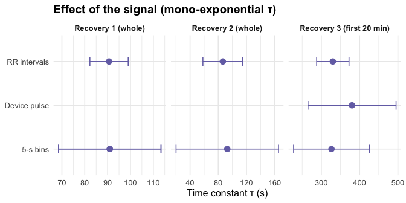

Figure 14: Mono-exponential time constant τ (with 95 % CI) obtained with
different signals.

</div>

For each recovery
(<a href="#fig-r3h-sensitivity-signal" class="quarto-xref">Figure 14</a>),
the mono-exponential time constant is similar whatever the signal: about
91 s for recovery 1, about 86–93 s for recovery 2, and 327–380 s over
the first 20 min of recovery 3. The confidence intervals overlap in all
cases, so our estimates of $\tau$ do not depend on the signal.

The confidence intervals are, however, much narrower with RR intervals.
This does not mean that RR intervals give a more precise estimate: with
more than 1 000 strongly autocorrelated beats, the standard errors
assume many more independent observations than there really are. The
wider intervals obtained with 5-s bins and pulse are probably more
realistic. The same bias affects the model comparison: over the first 20
min of recovery 3, the advantage of the bi-exponential model is large
with RR intervals ($\Delta AIC = 28.9$), but small with 5-s bins (1.9)
and pulse (6.1). On recovery 1, the bi-exponential model fitted on 5-s
bins collapses into the mono-exponential model ($\tau_1 = \tau_2 = 91$
s) and does not improve the fit.

Recovery 2 gives a time constant similar to recovery 1, but with a very
wide confidence interval, especially with 5-s bins (93 s, 95 % CI:
20–165 s). This is consistent with the previous section: during this
active recovery, heart rate barely decreases and none of the decay
models describes the data well ($R^2 \le 0.06$).

### Summary of findings for this recording

**Description of the recording.** The 3-hour recording does not contain
a single exercise followed by one recovery, but three exercise bouts
(0–13, 24–29 and 54–55 min), each followed by a recovery period.
Recovery 1 (13–24 min) is short and calm, recovery 2 (29–54 min) is
active (light movement continues), and recovery 3 (55–190 min) is long
and passive.

**H1: the mono-exponential model describes recovery better than the
linear model. Supported.** On all three recovery periods, the
mono-exponential model has a much lower AIC than the linear model
($\Delta AIC$ between 140 and 693). The linear model leaves a systematic
pattern in the residuals: it underestimates heart rate by 10–15 bpm at
the start of recovery and overestimates it later. It is also
physiologically implausible, since it predicts that heart rate keeps
falling indefinitely.

**H2: after intense exercise and over a long period, the bi-exponential
model fits better, with a fast (≈ 40–60 s) and a slower (≈ 2 min) time
constant (Joseph et al., 2023). Partly supported.** On the long recovery
(recovery 3), heart rate does show two processes: a fast decrease during
the first minutes, then a very slow decrease over more than two hours.
The bi-exponential model has the lowest AIC and its fast time constant
is stable across windows ($\tau_1 \approx$ 2.3–3.2 min). However, its
slow component is not a second recovery phase: its time constant (2.4 to
8 h) is always longer than the analysed window and its plateau is
physiologically impossible ($HR_\infty \approx 31$ bpm). A
mono-exponential model with a linear drift reaches the same accuracy
with one parameter less, and the advantage of the bi-exponential model
almost disappears when heart rate is averaged in 5-s bins. The second
part of H2 is supported: over the short recovery 1, the mono-exponential
model is sufficient and the bi-exponential model does not converge.

**H3: periods of continued movement deviate from the model, and the
plateau is higher than resting heart rate during active recovery.
Supported.** During recovery 2, heart rate stabilises around 99 bpm, far
above the 65–70 bpm reached at the end of the recording, and none of the
decay models explains the heart rate variations ($R^2 \le 0.06$). The
residuals follow the changes in movement. Recovery 1 also ends on a high
plateau (about 106 bpm), because it is interrupted by the next exercise
bout.

**Chosen model.** We retain the **mono-exponential model**, fitted on a
window limited to the post-exercise recovery itself (about the first 10
min). It is the most parsimonious model, its parameters are
physiologically interpretable, and its time constant is robust to the
signal used. It gives $\tau \approx 91$ s (about 1.5 min) after the
first exercise bout and $\tau \approx 174$ s (about 3 min) after the
last one. These values are of the same order of magnitude as those found
on the 7.5-min recording ($\tau \approx$ 49–63 s) and in the literature
($\tau \approx 65$ s after a maximal test, Joseph et al. (2023)), but
longer. When a long period after exercise is analysed, a linear drift
term must be added to describe the slow decrease of heart rate, as in
the 7.5-min recording. This drift is an empirical description, not a
recovery process.

**Limitations.**

- **Unknown protocol.** No activity labels are provided: the type and
  intensity of exercise are unknown. Exercise bouts were identified from
  a chest accelerometer, which does not detect well exercises with
  little trunk movement (probably the case during the first 10 min). The
  end of each bout ($t = 0$) depends on an arbitrary threshold (0.1 g)
  and has a 1-min resolution.
- **Interrupted recoveries.** Recoveries 1 and 2 are interrupted by the
  next exercise bout, so heart rate never returns to rest. Only recovery
  3 is long enough to study the full return to rest.
- **Uncontrolled conditions.** Posture, movement and breathing were not
  controlled, unlike in laboratory studies where participants recover
  lying down (Joseph et al., 2023). This may explain our longer time
  constants.
- **Slow drift.** The slow decrease over several hours may reflect
  prolonged rest, sleep or circadian variations rather than recovery
  from exercise; the data do not allow us to tell these apart.
- **Autocorrelated residuals.** For all models, residuals are strongly
  autocorrelated (Durbin–Watson 0.10–0.17). AIC differences, standard
  errors and confidence intervals computed on beat-to-beat data
  overstate the evidence and should be read as indicative.
- **Single participant.** The results come from one recording of one
  person and cannot be generalised.

## 7.5-minute recording with a falling heart rate

### Test your predictions using the dataset

The recording comes from an Aidlab chest strap (MIT licence). It lasts
450 s and contains ECG, beat-to-beat RR intervals, a 5-s pulse signal,
respiration, 3-axis acceleration and body position. All timestamps are
Unix milliseconds (UTC). We express time in seconds from the start of
the recording (`from_timestamp_ms` in `dataset.json`).

#### Data import and preparation

An **RR interval** is the time, in milliseconds, between two successive
heartbeats (two successive R waves of the ECG). Heart rate in beats per
minute is obtained by dividing one minute (60 000 ms) by this interval:

$$HR = \frac{60\,000}{RR}$$

For example, an RR interval of 400 ms corresponds to 150 bpm.

We use the RR intervals as the **main signal**, because each heartbeat
gives one HR value: about 1 000 points over the recording. The device’s
`pulse` signal gives only one HR value about every 5 s (91 values), so
it describes the recovery curve much less precisely. We keep `pulse` as
an **independent cross-check** of the RR-derived HR. We also import the
**acceleration**, to find out when the participant is moving, because
movement keeps HR high and therefore affects the recovery curve.

``` r
# Folder containing the 7.5-min recording
r7_dir <- "data/cardio-recovery-7m30s"

# Read the metadata to get the exact start time of the recording
r7_meta <- jsonlite::read_json(file.path(r7_dir, "dataset.json"))
r7_t0 <- r7_meta$from_timestamp_ms   # start time (Unix ms)

# Beat-to-beat heart rate from RR intervals
r7_rr <- read_csv(file.path(r7_dir, "rr.csv"), show_col_types = FALSE) |>
  mutate(t = (timestamp - r7_t0) / 1000,   # time from start, in seconds
         rr = value,                       # RR interval, in ms
         hr = 60000 / rr)                  # heart rate, in bpm

# Device heart rate (one value every ~5 s), used as a cross-check
r7_pulse <- read_csv(file.path(r7_dir, "pulse.csv"), show_col_types = FALSE) |>
  mutate(t = (timestamp - r7_t0) / 1000,   # time from start, in seconds
         hr = value)                       # heart rate, in bpm

# Acceleration: one row per sample, with x, y and z in g
r7_acc <- read_csv(file.path(r7_dir, "acceleration.csv"), show_col_types = FALSE) |>
  mutate(t = (timestamp - r7_t0) / 1000,          # time from start, in seconds
         mag = sqrt(x^2 + y^2 + z^2)) |>          # magnitude of the 3-axis vector
  group_by(t = floor(t / 10) * 10 + 5) |>         # 10-s windows, centred
  summarise(acc_sd = sd(mag), .groups = "drop")   # movement = SD within window

# Summary of the signals used
tibble(signal = c("RR intervals", "pulse", "acceleration (10-s windows)"),
       n = c(nrow(r7_rr), nrow(r7_pulse), nrow(r7_acc)),
       t_start_s = c(min(r7_rr$t), min(r7_pulse$t), min(r7_acc$t)),
       t_end_s = c(max(r7_rr$t), max(r7_pulse$t), max(r7_acc$t))) |>
  knitr::kable(digits = 1, caption = "Signals used in the analysis")
```

| signal                      |    n | t_start_s | t_end_s |
|:----------------------------|-----:|----------:|--------:|
| RR intervals                | 1004 |       1.1 |   449.5 |
| pulse                       |   91 |       4.8 |   449.5 |
| acceleration (10-s windows) |   45 |       5.0 |   445.0 |

Signals used in the analysis

Before fitting anything, we check the RR intervals for artefacts (missed
or extra beats). A common rule is to reject any interval that differs by
more than 20 % from the previous one.

``` r
# Flag RR intervals that differ by more than 20 % from the previous interval
r7_rr <- r7_rr |>
  mutate(rel_change = abs(rr / lag(rr) - 1),   # relative change vs previous beat
         artefact = !is.na(rel_change) & rel_change > 0.20)

# Quality summary
r7_quality <- r7_rr |>
  summarise(n_beats = n(),
            n_artefacts = sum(artefact),
            rr_min_ms = min(rr), rr_max_ms = max(rr),
            hr_min_bpm = min(hr), hr_max_bpm = max(hr))

knitr::kable(r7_quality, digits = 1, caption = "RR interval quality check")
```

| n_beats | n_artefacts | rr_min_ms | rr_max_ms | hr_min_bpm | hr_max_bpm |
|--------:|------------:|----------:|----------:|-----------:|-----------:|
|    1004 |           0 |       368 |       520 |      115.4 |        163 |

RR interval quality check

``` r
# Remove flagged intervals (if any)
r7_rr <- filter(r7_rr, !artefact)
```

0 interval(s) were rejected, so the RR series is clean. All RR values
stay between 368 and 520 ms (115–163 bpm), which is physiologically
plausible.

#### Identifying the exercise and recovery periods

Before fitting any model, we look at how heart rate changes over the
whole recording. This lets us find the exercise and recovery periods,
and check whether the recovery is regular enough to be described by a
single curve. We compare HR with the acceleration signal, because a
change in physical activity also changes HR: if the participant keeps
moving, HR stays higher than during passive rest.

We do not plot the raw acceleration. The accelerometer measures gravity
(about 1 g) as well as movement, so the raw values mostly reflect how
the sensor is oriented. We therefore compute the **magnitude** of the
acceleration vector, $\sqrt{x^2 + y^2 + z^2}$, which does not depend on
orientation, and then its **standard deviation (SD) in 10-s windows**.
When the participant is still, the magnitude stays close to 1 g and the
SD is close to 0. When the participant moves, the magnitude varies and
the SD increases. The SD is therefore a simple index of how much the
participant is moving.

``` r
# Time at which the participant stops moving (read from the acceleration plot)
r7_t_still <- 330

# Top panel: heart rate from RR (points) and from the device pulse (line)
r7_p1 <- ggplot() +
  geom_point(data = r7_rr, aes(t, hr), colour = "grey60", size = 0.6) +
  geom_line(data = r7_pulse, aes(t, hr), linewidth = 0.7) +
  geom_vline(xintercept = r7_t_still, linetype = "dashed") +
  labs(x = NULL, y = "Heart rate (bpm)") +
  theme_minimal()

# Bottom panel: movement index (SD of acceleration magnitude)
r7_p2 <- ggplot(r7_acc, aes(t, acc_sd)) +
  geom_col(fill = "steelblue", width = 9) +
  geom_vline(xintercept = r7_t_still, linetype = "dashed") +
  labs(x = "Time from start of recording (s)", y = "Acceleration SD (g)") +
  theme_minimal()

# Stack the two panels
patchwork::wrap_plots(r7_p1, r7_p2, ncol = 1, heights = c(2, 1))
```

<div id="fig-r7-overview">

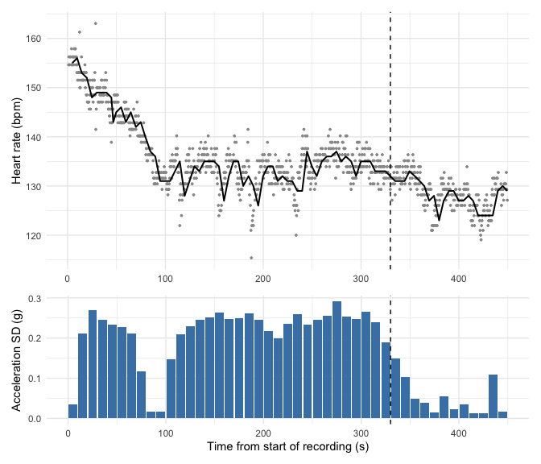

Figure 15: 7.5-min recording. Top: beat-to-beat HR from RR intervals
(grey) and device pulse (black). Bottom: movement (SD of acceleration
magnitude, 10-s windows). The dashed line at 330 s marks the moment the
participant stops moving.

</div>

What we observe:

- **No exercise period is visible.** HR is already about 155 bpm in the
  first seconds and starts falling right away. Exercise therefore ended
  before the recording started, but we do not know when. So $t = 0$ is
  the start of the recording, not the end of exercise.
- **Fast phase (≈ 0–90 s):** HR drops from about 155 to 131 bpm while
  the participant is moving (acceleration SD ≈ 0.2–0.27 g, a level
  consistent with light activity such as walking).
- **Short pause (≈ 80–100 s):** movement stops briefly (SD ≈ 0.02 g) and
  HR reaches a local minimum (~131 bpm).
- **Plateau (≈ 100–330 s):** movement starts again and HR stays around
  130–137 bpm instead of continuing to fall. This is an **active
  recovery**. The small HR rise around 240–290 s happens while the
  participant is moving.
- **Rest (≈ 330–450 s):** movement almost stops (SD \< 0.07 g) and HR
  drops again, to about 124–130 bpm.
- The body position signal only contains the label `unknown`, so it does
  not help.

We therefore consider the **whole recording (0–450 s) as the
post-exercise recovery period**. However, the activity is not constant:
it changes from active to passive recovery at about 330 s.

The shape of the curve, a steep drop followed by a slower decrease
towards a plateau, is what an exponential decay predicts (Section 2.1).
The match is not perfect: HR does not decrease smoothly, because of the
changes in movement. We therefore expect an exponential model to
describe the general trend but not every fluctuation.

Because $t = 0$ is not the end of exercise, we cannot estimate the true
HR drop since the end of exercise. Suppose exercise ended $\delta$
seconds before the recording started. In a mono-exponential model, the
excess HR at time $t$ of the recording is then

$$a\,e^{-(t+\delta)/\tau} = \left(a\,e^{-\delta/\tau}\right) e^{-t/\tau}$$

The unknown delay $\delta$ only changes the **amplitude** we estimate
(it becomes $a\,e^{-\delta/\tau}$, smaller than the true drop), but it
does **not** change the **time constant** $\tau$. Only $\tau$ can
therefore be compared with the literature.

#### Fitting the models

We fit the three required models to the beat-to-beat HR:

- **Linear:** $HR(t) = \beta_0 + \beta_1 t$. HR decreases at a
  **constant rate** ($\beta_1$ bpm per second) and never levels off.
- **Mono-exponential:** $HR(t) = HR_\infty + a\,e^{-t/\tau}$. HR falls
  **quickly at first, then more and more slowly**, and tends towards a
  plateau $HR_\infty$. The time constant $\tau$ is the time needed for
  the excess HR ($HR - HR_\infty$) to fall to about 37 % of its value.
- **Bi-exponential:**
  $HR(t) = HR_\infty + a_1 e^{-t/\tau_1} + a_2 e^{-t/\tau_2}$. HR is the
  sum of **two decays with different speeds**: a fast one ($\tau_1$) and
  a slow one ($\tau_2$), which could reflect two physiological processes
  (vagal reactivation and sympathetic withdrawal, Section 2.1).

The linear model is fitted with `lm()`. The exponential models are
non-linear in their parameters, so they are fitted by least squares with
`nls()`, which starts from initial values and improves them step by
step.

**Starting values.** We chose them from the overview plot
(<a href="#fig-r7-overview" class="quarto-xref">Figure 15</a>) and from
plausible physiological values:

- the plateau $HR_\infty$ is close to the lowest HR values reached (≈
  110–130 bpm);
- the amplitude $a$ (or $a_1 + a_2$) is roughly the drop from the start
  of the recording to the plateau (≈ 155 − 130 = 25 bpm);
- for the fast time constant, HR reaches the plateau after about 90 s,
  and an exponential is almost finished after 2–3 $\tau$, so
  $\tau \approx 30$–50 s;
- for the slow time constant, we tried several values (150, 400 and 1
  000 s), because the plot does not show it clearly.

The bi-exponential is sensitive to starting values, so we try these
three sets and keep the converged fit with the smallest residual sum of
squares. We use the `port` algorithm, which accepts bounds: amplitudes
$\ge 0$ and time constants $\ge 1$ s.

``` r
# Fit a bi-exponential from several starting points and keep the best one
r7_fit_biexp <- function(d) {
  # Three sets of starting values (see text)
  starts <- list(
    list(hr_inf = 125, a1 = 25, tau1 = 40, a2 = 5,  tau2 = 150),
    list(hr_inf = 110, a1 = 25, tau1 = 50, a2 = 25, tau2 = 1000),
    list(hr_inf = 120, a1 = 20, tau1 = 30, a2 = 10, tau2 = 400)
  )
  # Try each set; return NULL instead of stopping if the fit fails
  fits <- map(starts, \(s) tryCatch(
    nls(hr ~ hr_inf + a1 * exp(-t / tau1) + a2 * exp(-t / tau2),
        data = d, start = s, algorithm = "port",
        lower = c(0, 0, 1, 0, 1),           # bounds: hr_inf, a1, tau1, a2, tau2
        upper = c(200, 200, 1e4, 200, 1e5),
        control = list(maxiter = 500)),
    error = function(e) NULL))
  fits <- compact(fits)                     # drop the failed fits
  if (length(fits) == 0) return(NULL)       # no fit converged
  fits[[which.min(map_dbl(fits, deviance))]] # best fit = smallest residual SS
}

# Fit the three models to a data set with columns t and hr
r7_fit_models <- function(d) {
  list(
    linear = lm(hr ~ t, data = d),
    mono = nls(hr ~ hr_inf + a * exp(-t / tau), data = d,
               start = list(hr_inf = 130, a = 25, tau = 40)),
    bi = r7_fit_biexp(d)
  )
}

# Goodness-of-fit and residual indicators for a list of models
r7_indicators <- function(models, d) {
  imap(compact(models), \(m, name) {
    e <- resid(m)                                      # residuals
    tibble(model = name,
           k = length(coef(m)),                        # number of parameters
           RMSE = sqrt(mean(e^2)),                     # typical error (bpm)
           R2 = 1 - sum(e^2) / sum((d$hr - mean(d$hr))^2), # explained variance
           AIC = AIC(m),
           BIC = BIC(m),
           DW = sum(diff(e)^2) / sum(e^2),             # Durbin-Watson
           acf_lag1 = acf(e, plot = FALSE)$acf[2],     # lag-1 autocorrelation
           LjungBox_p = Box.test(e, lag = 10, type = "Ljung-Box")$p.value)
  }) |>
    list_rbind() |>
    mutate(dAIC = AIC - min(AIC), .after = AIC)        # difference to best AIC
}
```

To compare the models, we use two groups of indicators.

**Goodness of fit and complexity:**

- **RMSE** (root mean square error): the typical distance between the
  data and the model, in bpm. Lower is better.
- **R²**: the proportion of the HR variance explained by the model (0 to
  1). Higher is better, but it always increases when parameters are
  added.
- **AIC** and **BIC** (Akaike and Bayesian information criteria): they
  reward a good fit but **penalise the number of parameters** $k$, so a
  more complex model is only preferred if it improves the fit enough.
  BIC penalises extra parameters more strongly than AIC. Lower is
  better; **ΔAIC** is the difference from the best model, and a ΔAIC
  above about 10 means that a model is clearly worse.

**Residual structure** (a good model leaves residuals that look like
random noise, with no pattern over time):

- **Durbin–Watson (DW)**: about 2 if successive residuals are
  independent; values well below 2 mean that successive residuals are
  similar (positive autocorrelation).
- **Lag-1 autocorrelation**: the correlation between each residual and
  the next one; close to 0 for independent residuals.
- **Ljung–Box test**: tests whether the first 10 autocorrelations are
  all zero; a small p-value means the residuals are not random.

``` r
# Fit the three models on the whole recording
r7_models <- r7_fit_models(r7_rr)

# Compute and display the indicators
r7_ind <- r7_indicators(r7_models, r7_rr)

knitr::kable(r7_ind, digits = c(0, 0, 2, 3, 1, 1, 1, 2, 2, 3),
             caption = "Model comparison on the whole recording (0–450 s, beat-to-beat HR)")
```

| model  |   k | RMSE |    R2 |    AIC |  dAIC |    BIC |   DW | acf_lag1 | LjungBox_p |
|:-------|----:|-----:|------:|-------:|------:|-------:|-----:|---------:|-----------:|
| linear |   2 | 5.19 | 0.528 | 6162.0 | 620.0 | 6176.7 | 0.30 |     0.85 |          0 |
| mono   |   3 | 3.93 | 0.729 | 5607.2 |  65.2 | 5626.8 | 0.52 |     0.74 |          0 |
| bi     |   5 | 3.80 | 0.747 | 5542.0 |   0.0 | 5571.5 | 0.56 |     0.72 |          0 |

Model comparison on the whole recording (0–450 s, beat-to-beat HR)

``` r
# Predictions of each model on a 1-s time grid
r7_grid <- tibble(t = seq(0, max(r7_rr$t), by = 1))
r7_pred <- imap(compact(r7_models), \(m, name)
                mutate(r7_grid, model = name, hr = predict(m, newdata = r7_grid))) |>
  list_rbind()

# Data (grey points) and fitted curves (coloured lines)
ggplot(r7_rr, aes(t, hr)) +
  geom_point(colour = "grey70", size = 0.6) +
  geom_line(data = r7_pred, aes(colour = model), linewidth = 0.9) +
  geom_vline(xintercept = r7_t_still, linetype = "dashed") +
  labs(x = "Time from start of recording (s)", y = "Heart rate (bpm)",
       colour = "Model") +
  theme_minimal()
```

<div id="fig-r7-fits">

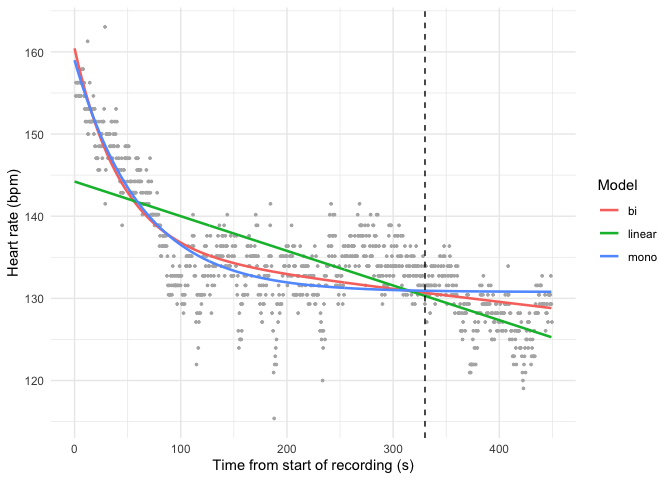

Figure 16: Linear, mono-exponential and bi-exponential fits to the
beat-to-beat heart rate (whole recording).

</div>

#### Fitted parameters

A good fit is not enough: the parameters must also be **estimated
reliably** and have a **physiological meaning**. For each parameter we
report its standard error (SE) and an approximate 95 % confidence
interval (estimate ± 1.96 SE). A narrow interval means the data
determine the parameter well; a very wide interval means the data cannot
tell its value. This is especially important for the time constants
($\tau$, $\tau_1$, $\tau_2$) and the plateau $HR_\infty$, which are the
parameters we want to interpret.

``` r
# Table of estimates, standard errors and Wald 95 % CI for one model
r7_param_table <- function(m, name) {
  s <- summary(m)$coefficients
  tibble(model = name, parameter = rownames(s),
         estimate = s[, 1], SE = s[, 2],
         CI_low = s[, 1] - 1.96 * s[, 2],
         CI_high = s[, 1] + 1.96 * s[, 2])
}

imap(compact(r7_models), r7_param_table) |>
  list_rbind() |>
  knitr::kable(digits = 3,
               caption = "Fitted parameters (Wald 95 % CI, whole recording)")
```

| model  | parameter   | estimate |         SE |      CI_low |    CI_high |
|:-------|:------------|---------:|-----------:|------------:|-----------:|
| linear | (Intercept) |  144.220 |      0.323 |     143.588 |    144.852 |
| linear | t           |   -0.042 |      0.001 |      -0.045 |     -0.040 |
| mono   | hr_inf      |  130.779 |      0.188 |     130.411 |    131.147 |
| mono   | a           |   28.211 |      0.661 |      26.916 |     29.506 |
| mono   | tau         |   62.779 |      2.672 |      57.543 |     68.016 |
| bi     | hr_inf      |    0.000 |   3435.206 |   -6733.003 |   6733.003 |
| bi     | a1          |   24.506 |      2.124 |      20.343 |     28.669 |
| bi     | tau1        |   43.621 |      6.167 |      31.533 |     55.709 |
| bi     | a2          |  135.923 |   3432.902 |   -6592.565 |   6864.411 |
| bi     | tau2        | 8364.469 | 219419.706 | -421698.155 | 438427.092 |

Fitted parameters (Wald 95 % CI, whole recording)

- **Linear:** HR falls by 2.5 bpm/min on average. This model has no
  physiological meaning: it would predict HR to keep falling
  indefinitely, which is impossible.
- **Mono-exponential:** $\tau =$ 62.8 s and $HR_\infty =$ 130.8 bpm. All
  parameters are precise and physiologically interpretable: HR tends
  towards about 131 bpm, the level kept up by the active recovery.
- **Bi-exponential:** the fast component ($\tau_1 \approx$ 43.6 s) is
  plausible, but the slow component is **not**: $\tau_2 \approx$ 8364 s
  (more than 2 hours, much longer than the 7.5-min recording),
  $a_2 \approx$ 136 bpm, and $HR_\infty \approx$ 0 bpm, stuck at the
  lower bound. When $\tau_2 \gg t$,
  $a_2 e^{-t/\tau_2} \approx a_2 - (a_2/\tau_2)\,t$. The “slow
  exponential” is just a **straight line** with slope -0.98 bpm/min.
  $HR_\infty$, $a_2$ and $\tau_2$ cannot be estimated separately (the
  model is not identifiable here), which is also why their standard
  errors are so large.

The data therefore do not contain a second exponential phase within 450
s. What the bi-exponential captures is a slow downward **drift**, caused
mainly by the end of movement at 330 s. To check this, we fit a more
parsimonious model with the same shape, a **mono-exponential plus a
linear drift** (4 parameters instead of 5):

$$HR(t) = HR_0 + a\,e^{-t/\tau} + b\,t$$

``` r
# Mono-exponential + linear drift (b = slope of the drift, bpm/s)
r7_drift <- nls(hr ~ hr0 + a * exp(-t / tau) + b * t, data = r7_rr,
                start = list(hr0 = 130, a = 25, tau = 40, b = 0))

r7_param_table(r7_drift, "mono + drift") |>
  knitr::kable(digits = 3, caption = "Mono-exponential + linear drift")
```

| model        | parameter | estimate |    SE |  CI_low | CI_high |
|:-------------|:----------|---------:|------:|--------:|--------:|
| mono + drift | hr0       |  135.907 | 0.611 | 134.710 | 137.104 |
| mono + drift | a         |   24.534 | 0.840 |  22.888 |  26.180 |
| mono + drift | tau       |   43.549 | 3.307 |  37.067 |  50.032 |
| mono + drift | b         |   -0.016 | 0.002 |  -0.020 |  -0.012 |

Mono-exponential + linear drift

``` r
# Compare all four models with the same indicators
r7_ind_all <- r7_indicators(c(compact(r7_models), list(`mono + drift` = r7_drift)), r7_rr)

knitr::kable(r7_ind_all, digits = c(0, 0, 2, 3, 1, 1, 1, 2, 2, 3),
             caption = "Comparison including the mono-exponential + drift model")
```

| model        |   k | RMSE |    R2 |    AIC |  dAIC |    BIC |   DW | acf_lag1 | LjungBox_p |
|:-------------|----:|-----:|------:|-------:|------:|-------:|-----:|---------:|-----------:|
| linear       |   2 | 5.19 | 0.528 | 6162.0 | 623.1 | 6176.7 | 0.30 |     0.85 |          0 |
| mono         |   3 | 3.93 | 0.729 | 5607.2 |  68.3 | 5626.8 | 0.52 |     0.74 |          0 |
| bi           |   5 | 3.80 | 0.747 | 5542.0 |   3.1 | 5571.5 | 0.56 |     0.72 |          0 |
| mono + drift |   4 | 3.80 | 0.747 | 5538.8 |   0.0 | 5563.4 | 0.56 |     0.72 |          0 |

Comparison including the mono-exponential + drift model

The mono-exponential + drift reproduces the bi-exponential: same fast
time constant ($\tau \approx$ 43.5 s), same slope. It has one parameter
less and a lower AIC and BIC. This confirms that the “second phase” of
the bi-exponential is a linear trend and not a second recovery process.

Nested models (mono-exponential vs bi-exponential) can also be compared
with an extra-sum-of-squares F-test:

``` r
# Does adding the second exponential reduce the residual SS significantly?
anova(r7_models$mono, r7_models$bi)
```

    Analysis of Variance Table

    Model 1: hr ~ hr_inf + a * exp(-t/tau)
    Model 2: hr ~ hr_inf + a1 * exp(-t/tau1) + a2 * exp(-t/tau2)
      Res.Df Res.Sum Sq Df Sum Sq F value    Pr(>F)    
    1   1001      15533                                
    2    999      14499  2 1034.2  35.631 1.129e-15 ***
    ---
    Signif. codes:  0 '***' 0.001 '**' 0.01 '*' 0.05 '.' 0.1 ' ' 1

The F-test is highly significant, but this is not enough to choose the
bi-exponential: its extra parameters are not interpretable, and the
residuals are strongly autocorrelated (next section). This violates the
independence assumption that the F-test and the standard errors rely on,
so their p-values are far too optimistic.

#### Residual analysis

``` r
# Residuals of the four models in one long table
r7_res <- imap(c(compact(r7_models), list(`mono + drift` = r7_drift)),
               \(m, name) tibble(model = name, t = r7_rr$t, resid = resid(m))) |>
  list_rbind() |>
  mutate(model = fct_inorder(model))   # keep the models in this order

# Residuals vs time, one panel per model, with a smooth trend line
ggplot(r7_res, aes(t, resid)) +
  geom_hline(yintercept = 0) +
  geom_point(size = 0.4, colour = "grey50") +
  geom_smooth(method = "loess", formula = y ~ x, span = 0.2, se = FALSE,
              colour = "steelblue") +
  geom_vline(xintercept = r7_t_still, linetype = "dashed") +
  facet_wrap(~model, ncol = 1) +
  labs(x = "Time from start of recording (s)", y = "Residual (bpm)") +
  theme_minimal()
```

<div id="fig-r7-residuals">

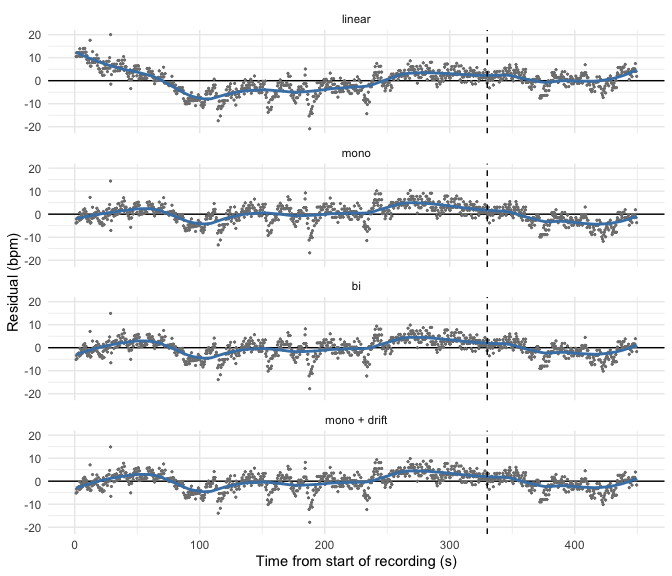

Figure 17: Residuals of each model versus time (whole recording). Blue
line: LOESS smooth. A good model should leave residuals randomly
scattered around 0.

</div>

``` r
# Autocorrelation function of the residuals (lags 0 to 30 beats) for each model
r7_res |>
  group_by(model) |>
  reframe(lag = 0:30, acf = acf(resid, lag.max = 30, plot = FALSE)$acf[, 1, 1]) |>
  ggplot(aes(lag, acf)) +
  geom_hline(yintercept = 0) +
  # 95 % bounds expected if the residuals were white noise
  geom_hline(yintercept = c(-1, 1) * 1.96 / sqrt(nrow(r7_rr)), linetype = "dashed") +
  geom_segment(aes(xend = lag, yend = 0)) +
  facet_wrap(~model, nrow = 1) +
  labs(x = "Lag (beats)", y = "ACF") +
  theme_minimal()
```

<div id="fig-r7-acf">

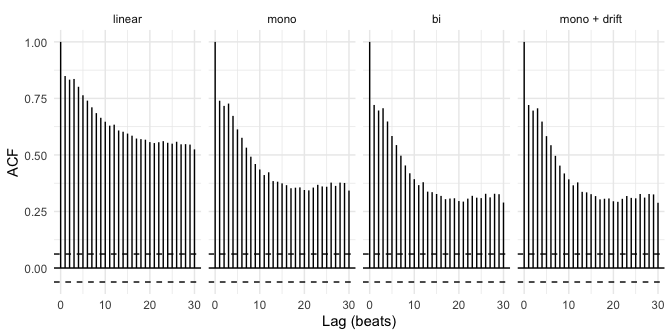

Figure 18: Autocorrelation of the residuals (lags in beats). Dashed
lines: approximate 95 % bounds for white noise.

</div>

- **Linear:** residuals show a clear pattern: positive at the start,
  negative in the middle, positive again. The model misses the curvature
  of the fast phase. This is a systematic error, not noise.
- **Mono-exponential:** the fast phase is captured well, but the
  residuals become negative after 330 s, when the participant stops
  moving and HR drops below the predicted plateau. There is also a
  negative dip around 100 s, which matches the short pause in movement.
- **Bi-exponential / mono + drift:** the end-of-recording trend is
  partly absorbed, but slow waves remain (for example around 240–290 s,
  a period of movement).
- **For all models**, residuals stay strongly autocorrelated (lag-1 ACF
  between 0.72 and 0.85, Durbin-Watson ≪ 2, Ljung-Box p ≈ 0). Part of
  this comes from the physiology: beat-to-beat HR oscillates with
  breathing (respiratory sinus arrhythmia) and with changes in movement.
  No smooth decay curve can capture this. As a result, the AIC, standard
  errors and F-test computed on ~1 000 beats overstate the evidence. The
  differences between models should be read as indicative.

#### Sensitivity analyses

The main analysis uses the whole recording (0–450 s). But the residuals
show that the participant’s activity changes at about 330 s: before,
they are still moving (active recovery); after, they are almost still
(passive rest). The decay models assume that the conditions stay the
same during recovery, and this change is not part of any of them. We
therefore refit the models **on the active part only (0–330 s)**, where
the activity is roughly constant, and compare the results with the whole
recording. If the estimates change a lot, they depend on the window
chosen, and the end-of-movement drop is affecting the fit.

We also check two choices about the data: (1) using the device’s
**pulse** signal instead of RR, and (2) averaging RR-derived HR into
**5-s bins** to reduce beat-to-beat noise and autocorrelation.

``` r
# Data sets for the sensitivity analysis
r7_active <- filter(r7_rr, t <= r7_t_still)      # active recovery only
r7_bins <- r7_rr |>                               # RR-derived HR averaged in 5-s bins
  group_by(t = floor(t / 5) * 5 + 2.5) |>
  summarise(hr = mean(hr), .groups = "drop")

r7_sens <- list(
  "RR, 0–450 s (main)" = r7_rr,
  "RR, 0–330 s (active only)" = r7_active,
  "Pulse, 0–450 s" = r7_pulse,
  "RR 5-s bins, 0–450 s" = r7_bins
)

# Refit the three models on each data set and keep the key results
r7_sens_tab <- imap(r7_sens, \(d, name) {
  ms <- r7_fit_models(d)
  ind <- r7_indicators(ms, d)
  tau <- coef(ms$mono)["tau"]
  tau_se <- summary(ms$mono)$coefficients["tau", 2]
  tibble(dataset = name,
         n = nrow(d),
         tau_mono = unname(tau),
         tau_low = unname(tau - 1.96 * tau_se),
         tau_high = unname(tau + 1.96 * tau_se),
         hr_inf_mono = unname(coef(ms$mono)["hr_inf"]),
         dAIC_linear = ind$AIC[ind$model == "linear"] - ind$AIC[ind$model == "mono"],
         bi_converged = !is.null(ms$bi),
         tau2_bi = if (is.null(ms$bi)) NA_real_ else unname(coef(ms$bi)["tau2"]))
}) |>
  list_rbind()

knitr::kable(r7_sens_tab, digits = 1,
             col.names = c("Data", "n", "τ mono (s)", "CI low", "CI high",
                           "HR∞ mono (bpm)", "AIC linear − AIC mono",
                           "Bi-exp converged?", "τ₂ bi-exp (s)"),
             caption = "Sensitivity of the results to the data and window used")
```

| Data | n | τ mono (s) | CI low | CI high | HR∞ mono (bpm) | AIC linear − AIC mono | Bi-exp converged? | τ₂ bi-exp (s) |
|:---|---:|---:|---:|---:|---:|---:|:---|---:|
| RR, 0–450 s (main) | 1004 | 62.8 | 57.5 | 68.0 | 130.8 | 554.8 | TRUE | 8364.5 |
| RR, 0–330 s (active only) | 748 | 48.6 | 44.2 | 53.0 | 132.8 | 662.3 | FALSE | NA |
| Pulse, 0–450 s | 91 | 65.0 | 50.0 | 80.0 | 130.2 | 64.1 | TRUE | 8388.8 |
| RR 5-s bins, 0–450 s | 90 | 63.4 | 48.4 | 78.5 | 130.7 | 61.3 | TRUE | 8207.7 |

Sensitivity of the results to the data and window used

``` r
# Shortcuts used in the text below
r7_s_main <- r7_sens_tab[1, ]
r7_s_act  <- r7_sens_tab[2, ]
r7_tau_range_full <- range(r7_sens_tab$tau_mono[-2])   # all whole-recording fits
```

- The **mono-exponential time constant is robust to the signal**:
  between 63 and 65 s on the whole recording, whether we use RR, pulse
  or 5-s bins. It **does depend on the window**. On the active window
  only it is shorter (48.6 s), close to the value obtained with the
  drift term (43.5 s). On the whole recording, the end-of-movement drop
  pulls the curve down and makes the exponential look slower than it is.
- The mono-exponential always beats the linear model by a large AIC
  margin (at least 61 AIC units).
- When the activity is constant (0–330 s), **the bi-exponential cannot
  be fitted at all**: there is no second exponential phase to estimate.
  Whenever it does converge, its slow component degenerates into a
  linear drift ($\tau_2$ of several thousand seconds).

#### Summary of findings for this recording

- The recording covers **recovery only**: exercise ended before the
  recording started, at an unknown time. The recovery is **active**
  until ~330 s (participant moving), then **passive**.
- The **linear model** is clearly rejected: worst fit (R² = 0.53),
  systematic curvature in the residuals, and no physiological meaning.
- The **mono-exponential model** is the best compromise. With only 3
  parameters it explains most of the variance and gives an interpretable
  time constant and a plateau (131–133 bpm) that matches the HR kept up
  by ongoing movement. Its best estimate is the one obtained on a window
  of constant activity: **$\tau \approx$ 49 s** (95 % CI 44–53 s, 0–330
  s). On the whole recording $\tau \approx$ 63 s, which is biased
  upwards by the late drop.
- The **mono-exponential + linear drift** has the lowest AIC/BIC on the
  whole recording, but its drift term is purely empirical: a straight
  line cannot continue forever. It is useful to show that the
  bi-exponential’s “slow phase” is only a trend, not as a physiological
  model.
- The **bi-exponential model is not justified** here. Its slightly
  better statistics come from a slow component that is mathematically a
  straight line and physiologically meaningless ($\tau_2$ \> 2 h). It
  cannot be fitted when the activity is constant. A 7.5-min recording is
  too short to identify a true slow recovery phase.
- The **remaining structure** in the residuals (late drop, mid-recording
  wave, autocorrelation) comes from **changes in physical activity and
  breathing**, not from the decay law itself. Any HRR model applied to
  this recording should account for the activity state (for example by
  fitting active and passive phases separately).

#### Link with our hypotheses

- **H1 (mono-exponential better than linear): supported.** The
  mono-exponential has a much lower AIC on every data set and less
  structured residuals.
- **H2 (bi-exponential better after intense exercise over a long
  period): not tested in a meaningful way here.** The recording is short
  and starts after exercise had already ended, so the conditions of H2
  are not met. As expected for a short recording, a mono-exponential is
  sufficient (Pierpont et al., 2013). Our time constants are
  nevertheless close to published values: the mono-exponential $\tau$ on
  the whole recording (63 s) is similar to the ≈ 65 s reported by Joseph
  et al. (2023), and the fast component of our bi-exponential
  ($\tau_1 \approx$ 44 s) matches their $\tau_1 \approx 44$ s. We do not
  find their slow component ($\tau_2 \approx 120$ s): in our data, the
  slow decrease is driven by the end of movement rather than by a second
  recovery process.
- **H3 (movement makes HR deviate from the model, with a higher plateau
  during active recovery): supported.** HR stays on a plateau of about
  133 bpm while the participant moves, drops below the mono-exponential
  prediction when movement stops at ~330 s, and the residuals follow the
  changes in movement. As in the walking recovery used by Cole et al.
  (1999), active recovery keeps HR above its resting level.

## Draw conclusions

**Which mathematical model best describes heart rate recovery?**

We compared linear, mono-exponential and bi-exponential models using two
recordings: 7.5 min and 3h10 min.

Based on both recordings, we would choose the mono-exponential model to
describe the initial decrease in heart rate after exercise because it
fits the data well, is relatively simple, and has fewer parameters than
the bi-exponential model, making its results easier to interpret.

- **Linear:** Has 2 parameters and is the simplest model. It fits the
  initial HR recovery less well than the mono-exponential model as it
  assumes heart rate decreases at a constant rate.
- **Mono-exponential:** Has 3 parameters and describes a fast initial
  decrease in heart rate followed by a slower decrease. This is
  consistent with the recovery pattern described by Pierpont et al.
  (2013).
- **Bi-exponential:** Has 5 parameters and allows two different recovery
  speeds as studied by Joseph et al. (2023). However, in the long
  recording, it fails to converge for Recovery 1 and gives
  difficult-to-interpret or unrealistic estimates for Recoveries 2 and
  3.

**Results Supporting Model Choice**

We compare the estimated time constants (τ) because they show how
quickly heart rate decreases during recovery. We also use MAE and R² to
check how well the models fit the data.

| Recording | Statistical evidence | Conclusion |
|----|----|----|
| **3h10m — Recovery 1** | Compared with the linear model, mono-exponential reduces MAE from **4.9 to 3.4 bpm** and increases R² from **0.37 to 0.65**. Estimated τ ≈ **91 s**. See <a href="#fig-r3h-rec1" class="quarto-xref">Figure 4</a>. | Mono-exponential fits the initial heart rate decrease better than linear. |
| **3h10m — Recovery 2** | Heart rate decreases slightly before stabilizing around **99 bpm**. All models perform similarly (R² ≤ 0.06). See <a href="#fig-r3h-rec2" class="quarto-xref">Figure 5</a>. | None of the models explains the heart rate variations well. The acceleration data suggest continued movement may influence the recovery pattern. |
| **3h10m — Recovery 3** | Mono-exponential gives τ ≈ **174 s** over the first 10 minutes. See <a href="#fig-r3h-sensitivity" class="quarto-xref">Figure 13</a>. | Initial recovery is slower than in Recovery 1. Over the full recovery period, more complex models fit better. |
| **7.5-minute recording** | Mono-exponential gives τ ≈ **49 s** for the first 330 seconds and **63 s** for the full recording. See <a href="#fig-r7-fits" class="quarto-xref">Figure 16</a>. | Mono-exponential describes the initial decrease well, but the estimates depend on the recovery duration used. |
| **Scientific literature** | Joseph et al. (2023) reported τ ≈ **65 s** after maximal treadmill exercise, with participants recovering lying down. | Our short recording gives similar values (49–63 s), but the long recording gives higher values (91 and 174 s). Differences in exercise intensity, movement and posture may help explain this. |

**Are there different recovery phases?**

The graph suggests two recovery phases: a fast decrease in heart rate
followed by a slower decrease
(<a href="#fig-r3h-rec3-zoom" class="quarto-xref">Figure 7</a>). This is
consistent with the recovery patterns discussed by Joseph et al. (2023).

However, our results do not clearly confirm two separate exponential
recovery phases. Although the bi-exponential model fits the data, it
gives unrealistic estimates, including a final heart rate of 31 bpm and
a slow recovery time of approximately 4.5 hours.

When we replace the second exponential component with a simple, steady
decrease (linear drift), the model fits almost as well (MAE = 6.45 bpm).
This shows that we can explain the slower decrease without needing a
second exponential process. Therefore, we cannot confirm that two
separate exponential recovery phases occurred.

**Were our hypotheses supported?**

The mono-exponential model was the preferred choice for initial heart
rate recovery for both recordings, but it does not describe every part
equally well. For longer recovery periods, the bi-exponential and
mono-exponential with linear drift models can provide better statistical
fits. Adding linear drift allows us to describe the continued slow
decrease without assuming a second exponential recovery process.

| Hypothesis | Result | Explanation |
|----|----|----|
| **H1 — Mono-exponential fits better than linear** | **Supported** | In both recordings, the mono-exponential model generally fits the initial heart rate decrease better. Heart rate drops quickly at first, then more slowly, rather than decreasing at a constant rate. |
| **H2 — Bi-exponential describes two recovery phases** | **Partly supported** | The long recording shows a fast decrease followed by a slower decrease, but the bi-exponential model gives unrealistic estimates for the slow phase. In the short recording, the 7.5-minute duration is too short to clearly identify a separate slow exponential phase, and the later decrease may be related to reduced movement. Therefore, we cannot confirm two separate exponential recovery phases. |
| **H3 — Continued movement affects recovery** | **Supported** | In the long recording, heart rate stabilizes around 99 bpm during Recovery 2 while movement continues. In the 7.5-minute recording, heart rate remains around 130–137 bpm during movement and decreases again when movement stops at approximately 330 s. These results support the hypothesis that continued movement influences heart rate recovery. See <a href="#fig-r3h-rec2" class="quarto-xref">Figure 5</a> and <a href="#fig-r7-overview" class="quarto-xref">Figure 15</a>. |

**Limitations**

We do not know exactly what exercise was performed, how intense it was,
or when it ended. We used acceleration to estimate activity periods, but
movement does not always mean exercise.

Our results also depend on how much of the recovery period we analyze. A
short period mainly captures the initial fast decrease, while a longer
period may also include slower changes in heart rate.

We also tested different heart rate measurements (RR intervals, pulse
data, and 5-second averages). These can give slightly different results
because they measure or summarize heart rate differently.

Heart rate measurements taken close together are usually similar, so
they do not give us completely new information. This can make our
confidence intervals too narrow, meaning we may be less certain about
our results than the calculations suggest.

We only studied two recordings, so we cannot assume everyone recovers in
the same way.

Overall, the mono-exponential model is our preferred choice for initial
heart rate recovery. For longer recovery periods, a mono-exponential
model with linear drift may better describe the continued slow decrease
in heart rate. However, neither model fully accounts for the effects of
continued movement.

# Team workflow using Git

## Repository and initial setup

Jennifer created the public repository `IEAP-Series04-Rstudio` and added
Sarah and Alexis as collaborators. Her first commits set up the whole
project **before** anyone started working on the questions: `README.md`,
`LICENSE`, `.gitignore`, the RStudio project, the master document
`IEAP-Series04-Rstudio.qmd`, the bibliography style (`styles/apa.csl`),
the two data sets and one empty file per part of the report in
`sections/`. Each section file initially contained the instructions of
its question as a comment, so that everyone knew exactly what to write
and where.

The `.gitignore` was written at this stage, as required, so that no
local or temporary file could enter the history:

- RStudio and R session files (`.Rproj.user/`, `.Rhistory`, `.RData`,
  `.Ruserdata`), which are specific to each computer;
- system files (`.DS_Store`, `Thumbs.db`);
- Quarto temporary files and caches (`.quarto/`, `*_cache/`) and LaTeX
  temporary files (`*.aux`, `*.log`, `*.toc`…), which are regenerated at
  every render.

## One file and one branch per part

The master document only contains the YAML header, the setup chunk and
one `include` line per section. Each part of the report lives in its own
file, and each file has a single owner:

| Section | File | Branch | Owner |
|:---|:---|:---|:---|
| Random noise and linear regression | `01_random_noise.qmd` | `01_random_noise` | Jennifer |
| Literature and hypotheses | `02_literature_and_hypotheses.qmd` | `02_literature_and_hypotheses` | Sarah |
| 3h10m recording | `03_recovery_3h10m.qmd` | `03_recovery_3h10m` | Sarah |
| 7.5-min recording | `04_recovery_7m30s.qmd` | `04_recovery_7m30s` | Alexis |
| Conclusions | `05_model_comparison.qmd` | `05_model_comparison` | Jennifer |
| Git workflow | `06_git_workflow.qmd` | `06_git_workflow` | Alexis |

The branch names follow a single pattern, `<section number>_<topic>`, so
each branch can be matched to its file and to its question at a glance.
Because two people never edit the same file, the branches could be
developed in parallel without merge conflicts. The only shared file,
`references.bib`, was edited on a single branch
(`02_literature_and_hypotheses`).

Since all sections are rendered in the same R session, two sections
could overwrite each other’s objects (for example two different `models`
or `data` objects). To avoid this, each section prefixes its objects and
chunk labels: `r7_` / `r7-` for the 7.5-min recording and `r3h_` /
`r3h-` for the 3h10m recording.

## Pull requests and peer review

No section was merged directly into `main`. When a section was ready,
its owner opened a **pull request** on GitHub and asked the two other
members for a review. Reviewers commented on specific lines (clarity of
the explanations, missing justifications, rendering problems,
consistency with the other sections), and the owner answered each
comment with new commits on the same branch before the merge.

For example, the pull request of the 7.5-min recording (#1) received 16
review comments. They were addressed in 10 separate commits, one per
comment (e.g. `Explain RR intervals and choice of HR signal`,
`Replace hardcoded values with inline R`), so that the history shows how
each remark was handled. Pull requests were merged with **“Create a
merge commit”** rather than “Squash and merge”, so that every individual
commit stays visible in `main`
(e.g. `Merge pull request #2 from jenniferhoumard/01_random_noise`).

## Order of the merges

The sections depend on each other: the recording analyses (03, 04) cite
the references added in section 02, and the conclusions (05) refer to
the figures and results of sections 03 and 04. The pull requests are
therefore merged in the order of the report (01 → 02 → 03 → 04 → 05 →
06). After each merge, the owners of the remaining branches merge `main`
into their branch, so that they work with the latest shared files and
can check that their section still renders with the rest of the report.

## Commit messages

Each commit does one step of a question, and its message describes this
step in the imperative: `Import recovery signals for analysis`,
`Check RR artefacts and recording gaps`,
`Add mono-exponential drift recovery model`,
`Proposed a better numerical experiment`. Each question has several
commits (between 2 and more than 30 per branch), so the history shows
how each analysis was built.

## What went wrong and what we learned

- **Commits directly on `main`.** Two small fixes were committed
  directly on `main` after the setup (`Removed html format`,
  `Add quarto yml file`). The second one was needed because Quarto
  executed the code of each section from the `sections/` folder, so the
  relative paths to `data/` failed. Adding a `_quarto.yml` with
  `execute-dir: project` solved it for everyone. In hindsight, these
  fixes should also have gone through a short branch and a pull request.
- **Working on an outdated branch.** Jennifer merged `main` into
  `04_recovery_7m30s` on GitHub to bring the `_quarto.yml` fix, but
  Alexis then committed on his local copy without pulling first. Git had
  to create an extra merge commit when he pushed. Running `git pull`
  before starting to work avoids this.
- **“It works on my computer.”** A section rendered on its author’s
  computer but not from a clean session, because some objects still
  existed in the RStudio environment but were never created in the file.
  Rendering the whole report from a fresh session before opening a pull
  request, and asking reviewers to render it too, catches these errors.
- **Consistency between sections.** Reviews were not only about code:
  they also caught contradictions between sections (for example, the
  same hypothesis judged “supported” in one section and “partly
  supported” in another). Reviewing each other’s work made the report
  more coherent than three separate parts.
- **Commit message style.** Most messages use the imperative (`Add…`,
  `Explain…`), but some use the past tense (`Added…`, `Removed…`).
  Agreeing on one convention at the start would make the history more
  uniform.

# References

<div id="refs" class="references csl-bib-body hanging-indent"
data-entry-spacing="0" data-line-spacing="2">

<div id="ref-cole1999" class="csl-entry">

Cole, C. R., Blackstone, E. H., Pashkow, F. J., Snader, C. E., & Lauer,
M. S. (1999). Heart-rate recovery immediately after exercise as a
predictor of mortality. *The New England Journal of Medicine*,
*341*(18), 1351–1357. <https://doi.org/10.1056/NEJM199910283411804>

</div>

<div id="ref-joseph2023" class="csl-entry">

Joseph, A., Kanthakumar, P., & Tharion, E. (2023). Exponential modelling
of heart rate recovery after a maximal exercise. *Indian Journal of
Physiology and Pharmacology*, *67*(2), 125–130.
<https://doi.org/10.25259/IJPP_122_2022>

</div>

<div id="ref-pierpont2013" class="csl-entry">

Pierpont, G. L., Adabag, S., & Yannopoulos, D. (2013). Pathophysiology
of exercise heart rate recovery: A comprehensive analysis. *Annals of
Noninvasive Electrocardiology*, *18*(2), 107–117.
<https://doi.org/10.1111/anec.12061>

</div>

</div>
