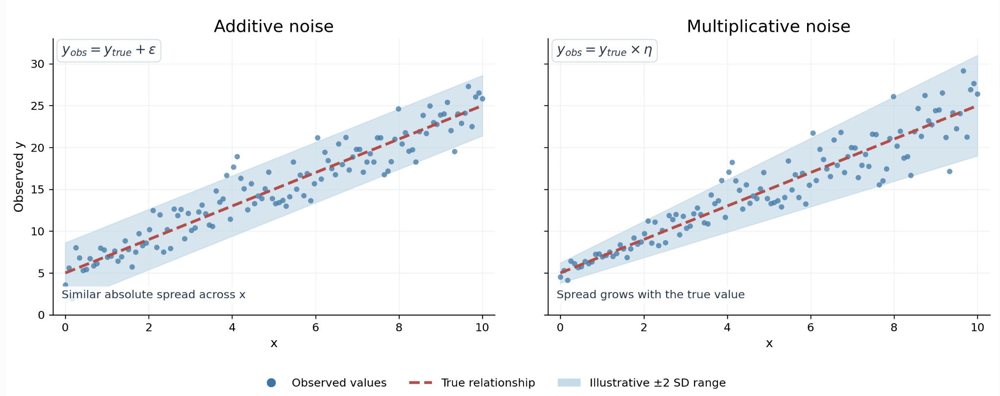
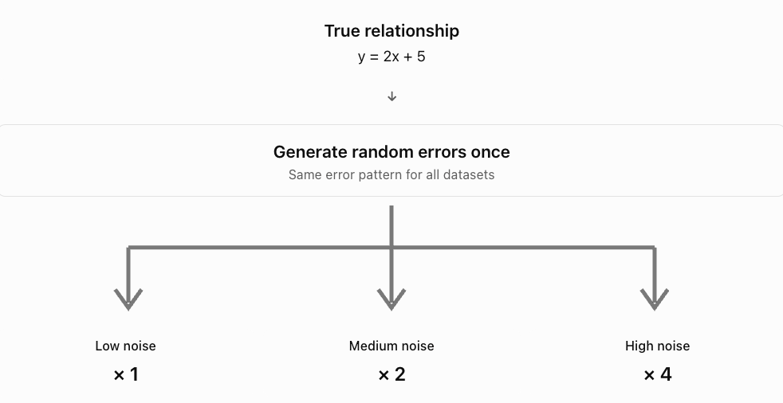
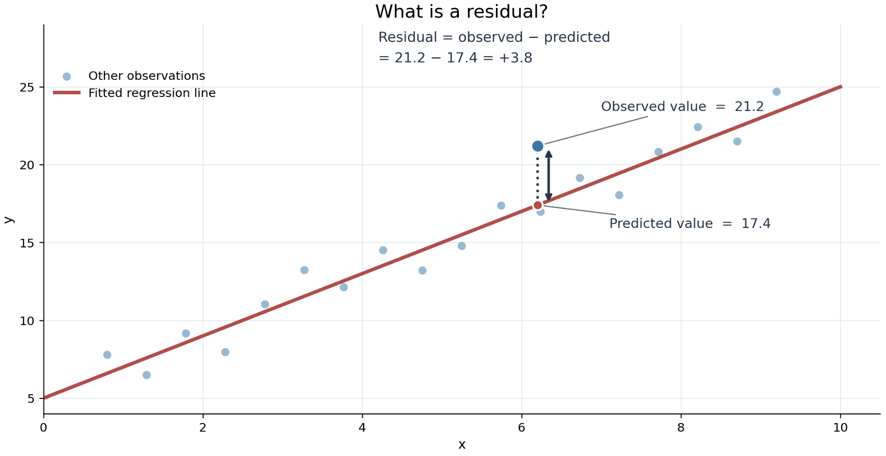

In real-life experiments, we collect measurements and use linear regression to estimate the relationship between variables. However, we usually do not know the true relationship, and the data can contain random noise. This makes it difficult to know how accurately the regression line represents the underlying relationship. 


Synthetic data allows us to investigate this problem because we can define the true linear relationship ourselves and control the amount of noise added. By increasing the noise while keeping the true relationship the same, we can compare the estimated regression lines with the known equation. This helps us understand how random noise affects the accuracy and reliability of linear regression. 

Although synthetic data cannot prove whether a relationship in real measurements is correct, they help us understand the limitations of regression when analyzing noisy experimental data.

## Formulate your expectations

A linear regression model describes the relationship between two variables using a straight line. 

$$\boxed{y = mx + b}$$

where:

- $m$ = the slope

- $b$ is the intercept. 

In the pre-series, we learned about two types of random noise:

1. **Additive noise:** Random errors are added to the data, more specifically to the dependent variable ($y$). The size of the errors does not depend on the original values of $y$. 

$$\boxed{y_{\text{obs}} = mx + b + \varepsilon}$$

2. **Multiplicative noise:** The dependent variable ($y$) is multiplied by random factors. This means the absolute errors can become larger when the original values of $y$ are larger. 

$$\boxed{y_{\text{obs}} = (mx + b)\eta}$$

Both types of noise can also be combined, which can make simulated data more realistic when measurements contain both types of error. 

$$\boxed{y_{\text{obs}} = (mx + b)\eta + \varepsilon}$$

Adding noise makes the observed data points more scattered around the true linear relationship.  

**a). Estimated slope**

We expect the estimated slope and intercept to change when the noise increases. The fitted line may become steeper or flatter depending on where the noisy observations are located. 

However, if the noise has a mean of zero and does not depend on x, we do not expect the slope or intercept to always increase or decrease. Instead, their estimates should become less precise as noise increases. 

**b). Quality of predictions**

We expect predictions to become less accurate as noise increases. The data points will generally be more spread out around the regression line, leading to larger differences between observed and predicted values (residuals or errors).

Noise can also affect the sample mean. In general, increasing the number of observations makes the sample mean a more precise estimate of the population mean. However, increasing random noise makes the sample mean less precise.

If the noise has a mean of zero, positive and negative errors tend to cancel out when enough observations are collected. Therefore, we expect that a larger sample size can help reduce the effect of random noise on our estimates.

**c). Explained variance**

We expect $R^2$ to generally decrease as noise increases. This is because more of the variation in the data comes from random noise rather than the relationship between x and y. 

Therefore, the regression model will explain a smaller proportion of the observed variation.

**d). Estimated linear relationships**

We expect the estimated regression lines to be different as random noise increases. This is because noise makes the data points more scattered, which can change the estimated slope and intercept. As a result, the observed linear relationships will generally become less clear, and the regression model will explain less of the variation in the data.

However, the true linear relationship used to generate the data will remain the same because we are only adding random noise to the observations, not changing the original equation used to generate the data. Only the estimated regression lines may change. 


## Implement and investigate

To investigate how random noise affects linear regression, we generated three synthetic data sets using the same underlying linear relationship. The original linear relationship is defined as:

$$\boxed{y_{\text{true}}=2x+5}$$
As in the pre-series, we combined additive and multiplicative noise to simulate data: 

$$\boxed{y_{\text{obs}} = (2x + 5)\eta + \varepsilon}$$

{width=70%}


**Additive noise** has a mean of 0 because the errors are centered around 0. This means that positive and negative errors tend to cancel out on average when enough observations are collected. If the errors had a positive or negative mean, the observed values would be systematically overestimated or underestimated compared to the true values. We want the observed values to remain equal to the true values on average because we are keeping the underlying linear relationship the same. Only the data points should become more scattered around the true linear relationship. Adding 0 to the true value does not change the overall average trend, which is what we want. 

$$\boxed{y_{\text{obs}} = y_{\text{true}} + \varepsilon}$$

**Multiplicative noise** has a mean of 1 because the factors that multiply the true values are centered around 1. Multiplying the true values by 1 does not change the overall average trend, which is what we want. This means there will be no systematic overestimation or underestimation of the observed values.

$$\boxed{y_{\text{obs}} = y_{\text{true}} * \eta}$$

The goal is to increase the amount of random variation without changing the true underlying relationship. To do this, we maintain a mean of 1 for the multiplicative factor and 0 for the additive noise, so the observed values remain centered around the true linear relationship. However, we increase the standard deviation of the noise to create more random variation. This will generally increase the distance between the observed values and the true linear relationship.  

### Generating Synthetic Datasets

{width=70%}

We generated three datasets from the same true relationship, (y = 2x + 5), allowing us to compare how increasing noise affects the regression results. Each contains 120 observations with the same values of (x), ranging from 0 to 10.

We first generated additive and multiplicative noise using random numbers. We then used these same numbers for all three datasets, but multiplied them by 1, 2 and 4 to create low, medium and high noise levels.

This means we generate random errors once. Instead of generating completely new errors for every dataset, we make those original errors twice as large for the second dataset and four times as large for the third.

We used set.seed(123) to make sure we obtain the same results each time we run the code.

We chose to use the same random errors multiplied by 1, 2 and 4 rather than generating completely different errors for each dataset because this allows us to control the experiment because only the magnitude of the noise changes, while the random error pattern remains the same.

If we generated different random errors for each dataset, some errors could partly cancel each other out by chance. This means that a dataset with higher noise could sometimes produce regression estimates closer to the true values than a dataset with lower noise. We would then have difficulty determining whether the differences between the models were caused by the amount of noise or simply by the particular random errors generated.

By keeping the same error pattern and increasing only its magnitude, we can more clearly observe how increasing noise affects the regression results.

```{r}
# Import libraries
library(tidyverse)
library(lmtest)

# 1. Define the true linear relationship

set.seed(123) # reproduces the same random numbers every time the code is run

n <- 120 # number of observations

x <- seq(0, 10, length.out = n) # 120 values from 0 to 10

y_true <- 2 * x + 5 # true linear relationship without noise
```

For multiplicative noise, we want to increase the standard deviation without changing the mean of the multiplicative factor, which should stay at 1.

If we generate multiplicative noise with a mean of 1 and then multiply it by 2 or 4, the mean would also increase to 2 or 4. This would change the original linear relationship, which is not what we want.

Instead, we generate multiplicative errors with a mean of 0, so multiplying them by 2 or 4 increases their standard deviation without changing their mean. We then add 1 in the equation to keep the multiplicative factor centered around 1.

For additive noise, we do not need to add 1 because it is already centered around 0. Multiplying the errors by 2 or 4 increases their standard deviation while keeping their mean at 0.

```{r}
# 2. Generate additive and multiplicative noise once

# Additive noise
additive_noise <- rnorm(n, mean = 0, sd = 1) 
# Generate additive random errors centered around 0

multiplicative_noise <- rnorm(n, mean = 0, sd = 0.050) 
# Generate multiplicative random errors centered around 0

```

```{r}
# 3. Generate three datasets with increasing noise

# Low noise level
y_low <- data.frame(
  x = x,
  y_obs = y_true * (1 + multiplicative_noise) + additive_noise
)

# Medium noise level
y_medium <- data.frame(
  x = x,
  y_obs = y_true * (1 + 2 * multiplicative_noise) + 2 * additive_noise
)

# High noise level
y_high <- data.frame(
  x = x,
  y_obs = y_true * (1 + 4 * multiplicative_noise) + 4 * additive_noise
)

```

### Fit a Linear Regression and Plot 

```{r}
# 4. Fit linear regression models to each dataset

lm_low <- lm(y_obs ~ x, data = y_low) # low noise
lm_medium <- lm(y_obs ~ x, data = y_medium) # medium noise
lm_high <- lm(y_obs ~ x, data = y_high) # high noise

# 5. Summary statistics for each model

summary(lm_low)
summary(lm_medium)
summary(lm_high)
```

### Define a function to add linear regression and confidence intervals to the datasets

```{r}
# 6. Define a function to add linear regression and confidence intervals to the datasets

add_regression_to_data <- function(data, model, ci = 0.95) {

  conf_interval <- predict(model, interval = "confidence", level = ci)
  # Calculate the fitted values and confidence interval limits

  data <- cbind(data, conf_interval)
  # Add these values as new columns in the dataset

  return(data) # Return the updated dataset
}
```


```{r}
# 7. Apply the function to the three datasets

# Low noise 
y_low_ci <- add_regression_to_data(y_low, lm_low)

# Medium noise
y_medium_ci <- add_regression_to_data(y_medium, lm_medium)

# High noise
y_high_ci <- add_regression_to_data(y_high, lm_high)

#print(y_low)
#print(y_medium)
#print(y_high)

```

### Plot the datasets with their regression and confidence intervals

```{r}
# 8.Function to plot the datasets with its regression and confidence interval

plot_regression <- function(data, title) {

  ggplot(data, aes(x = x, y = y_obs)) +
    geom_ribbon(aes(ymin = lwr, ymax = upr),
                fill = "lightblue", alpha = 0.3) + # 95% confidence interval
    geom_point() + # Observed data points
    geom_line(aes(y = fit, color = "Estimated regression")) + # Fitted regression
    geom_line(aes(y = 2 * x + 5, color = "True relationship")) + # True regression
    scale_color_manual(values = c(
      "Estimated regression" = "blue",
      "True relationship" = "red"
    )) +
    labs(title = title, x = "x", y = "Observed y", color = "Lines") +
    theme_minimal()
}

# Generate the three plots separately
plot_regression(y_low_ci, "Low Noise")
plot_regression(y_medium_ci, "Medium Noise")
plot_regression(y_high_ci, "High Noise")
```

### Diagnostic Plots

All three models produce nearly identical diagnostic patterns, despite having different noise levels. This is because we used the same random errors for all three datasets. Consequently, the residuals follow exactly the same pattern, but their magnitudes are multiplied by 1, 2 and 4.

{width="70%"}

A residual is the difference between an observed value and the value predicted by the regression model.


```{r}
# 9. Diagnostic plots for low noise
plot(lm_low)
```

```{r}
# Diagnostic plots for medium noise
plot(lm_medium)
```


```{r}
# Diagnostic plots for high noise
plot(lm_high)
```

**a) Residuals vs Fitted:** The residuals are scattered around zero without a strong curved pattern, suggesting that a linear relationship is appropriate. However, the absolute residual values increase substantially between the low-, medium- and high-noise models.

**b) Normal Q-Q:** Most points follow the reference line, with some deviations at the extremes. This suggests that the residuals are approximately normally distributed.

**c) Scale-Location:** The points show no strong increasing or decreasing pattern in their spread, although there are small variations. There is no clear visual evidence of strongly non-constant variance.

**d) Residuals vs Leverage:** A few observations have relatively large standardized residuals, particularly observation 44, but there is no obvious evidence of highly influential observations based on the plots.

### Statistical Tests

After fitting the three linear regression models, we checked the residuals to see whether the assumptions of linear regression were satisfied. 

The **Shapiro-Wilk test** checks whether the residuals are normally distributed. In linear regression, the original data do not need to be normally distributed, but the errors are assumed to be normally distributed for the usual statistical tests and confidence intervals to be exact. This is because these tests use mathematical distributions to calculate p-values and confidence intervals. When the errors are normally distributed, we know how the estimated regression coefficients are expected to vary, allowing us to calculate their uncertainty. If the errors are not normally distributed, these calculations may be less accurate, especially with small samples. However, normality is not necessary to calculate the regression line itself.

The **Breusch-Pagan test** checks whether the residual variance is constant (homoscedasticity). This means checking whether the errors have around the same spread across the fitted/predicted values. If the variance is not constant, the usual standard errors and confidence intervals may be unreliable. 

We use a standard significance level of 0.05 to interpret both tests.

| Test | p-value ≥ 0.05 | p-value < 0.05 |
|---|---|---|
| Shapiro–Wilk | No significant evidence against normality | Evidence that residuals are not normally distributed |
| Breusch–Pagan | No significant evidence against constant variance | Evidence that residual variance is not constant |

A p-value above 0.05 does not prove that an assumption is satisfied.

```{r}
# 10. Check the residuals of the three regression models

# a) Shapiro-Wilk test: check if residuals are normally distributed

shapiro.test(residuals(lm_low)) # low noise
shapiro.test(residuals(lm_medium)) # medium noise
shapiro.test(residuals(lm_high)) # high noise

# b) Breusch-Pagan test: check if residual variance is constant

bptest(lm_low) # low noise
bptest(lm_medium) # medium noise
bptest(lm_high) # high noise
```


### Comparison of Regression Models

**1. Low Noise:**

The estimated intercept is 5.139 and the slope is 1.971, both very close to the true values of 5 and 2. The R² of 0.958 indicates that the model explains approximately 95.8% of the variation in the observed data. The residual standard error of 1.219 shows that observations are relatively close to the fitted regression line.

In the regression plot, the observed points are closely grouped around the true relationship. The estimated regression line almost overlaps with the true line, and the confidence interval is narrow.

**2. Medium Noise:**

The estimated intercept increases to 5.279, while the slope decreases to 1.943, moving slightly further from the true values. The R² decreases to 0.845, meaning the model now explains approximately 84.5% of the variation. The residual standard error increases to 2.439, approximately twice that of the low-noise model.

The observed points are more scattered around the regression line, and the confidence interval becomes wider. However, the estimated regression line remains close to the true relationship.

**3. High Noise:**

The estimated intercept is 5.558 and the slope is 1.886, showing the largest differences from the true values. The R² decreases further to 0.563, meaning the model explains only 56.3% of the variation. The residual standard error increases to 4.877, four times that of the low-noise model.

The regression plot shows much greater scatter around the line, and the confidence interval is considerably wider. Although the estimated regression line still follows the overall linear trend, its coefficients are less precise.

As noise increases, the estimated coefficients move further from the true values in this experiment. At the same time, R² decreases, while the residual and slope standard errors increase.

The slope remains statistically significant in all three models (p-value < 0.001). This means that even at high noise levels, there is strong evidence of a linear relationship, although the model explains less of the observed variation.

```{r}
# 11. Create a table to compare the three regression models

comparison <- data.frame(
  Noise = c("Low", "Medium", "High"),

  Intercept = c(coef(lm_low)[1],
                coef(lm_medium)[1],
                coef(lm_high)[1]),

  Slope = c(coef(lm_low)[2],
            coef(lm_medium)[2],
            coef(lm_high)[2]),

  R_squared = c(summary(lm_low)$r.squared,
                summary(lm_medium)$r.squared,
                summary(lm_high)$r.squared),

  Residual_SE = c(summary(lm_low)$sigma,
                  summary(lm_medium)$sigma,
                  summary(lm_high)$sigma),

  # Standard error of the estimated slope
  Slope_SE = c(summary(lm_low)$coefficients[2, 2],
               summary(lm_medium)$coefficients[2, 2],
               summary(lm_high)$coefficients[2, 2]),

  # Shapiro-Wilk test p-values
  Shapiro_p = c(shapiro.test(residuals(lm_low))$p.value,
                shapiro.test(residuals(lm_medium))$p.value,
                shapiro.test(residuals(lm_high))$p.value),

  # Breusch-Pagan test p-values
  BP_p = c(bptest(lm_low)$p.value,
           bptest(lm_medium)$p.value,
           bptest(lm_high)$p.value)
)

# Display the comparison as a table in the PDF
knitr::kable(comparison, digits = 3)
```

**4. Statistical Tests:**

The Shapiro–Wilk and Breusch–Pagan tests also produce identical results because multiplying all residuals by the same positive number does not change their test statistics.

For the Shapiro–Wilk test, all p-values are greater than 0.05. Therefore, we do not find significant evidence that the residuals deviate from normality.

For the Breusch–Pagan test, all p-values are also greater than 0.05. Therefore, we do not find significant evidence that the residual variance is non-constant.

## Draw Conclusion

Our main expectations were confirmed. As random noise increased, the observations became more scattered, the regression models explained less variation, and the estimated coefficients became less precise.

The differences between the three models support this. R² decreased from 0.958 to 0.563, while the residual standard error increased from 1.219 to 4.877. The slope and intercept also moved further from their true values. However, the slope became smaller and the intercept larger, showing that random noise does not necessarily change regression coefficients in a particular direction.

These results suggest that increasing noise reduces regression fit and prediction precision. With more noise, individual observations are harder to predict accurately, and we become less certain about the estimated relationship. However, all three models still detected a statistically significant linear relationship, showing that a relationship can remain detectable even when the observations contain substantial noise.

Finally, the diagnostic tests showed that increasing the magnitude of the noise did not change the residual distribution or its relative pattern in our experiment. Therefore, more noise does not automatically mean that the assumptions of linear regression are violated.

## Propose a better numerical experiment

We could also test additive and multiplicative noise separately to better understand how each type affects regression estimates and model assumptions. However, combining both types of noise is also important because real-world data can contain several sources of error at the same time.

Another improvement would be to evaluate the models using a separate test dataset. This would allow us to measure how increasing noise affects the accuracy of predictions on new observations, rather than only evaluating how well the models fit the original data.

Finally, we could extend the experiment to other relationships, such as quadratic, polynomial or exponential relationships, because real-world data do not always follow a straight line. We could then investigate whether increasing noise has similar effects on different types of regression models.

We could also compare these models with more flexible machine learning methods. Unlike models where we choose a specific equation, some machine learning methods can learn complex patterns directly from the data. This could be useful when the underlying relationship is unknown.

However, more flexible models are not necessarily better because they may also learn random errors rather than the true relationship, which is called overfitting. By comparing the models at different noise levels and evaluating their predictions on separate test data, we could investigate whether more flexible models improve prediction accuracy or become more sensitive to noise.

